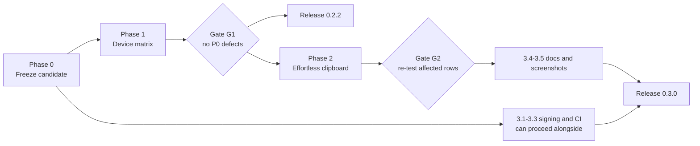

# Seamless clipboard: newest copy wins, virtual files, formatted text

Goal (owner, 7 November 2026): anything copied on one PC is on every connected PC's clipboard without clicking Copy in Hopboard, in both directions. Android receive stays as it is (text only).

## Why a manual Copy was still needed

With automatic sharing, images and files all on, the owner still had to click Copy. Any local copy that was not shared (a private copy, a Cut, a copy made while offline, or non-text content present at startup) left the receiver "protected" until a manual Copy, so every later item waited. Files above the 256 MiB auto-download limit also waited for Download, and no file was on the clipboard until its whole download finished.

## What changed

- **Newest copy wins (Windows only, default on, setting "Newest copy always wins").** A live item from another device replaces the clipboard even over an unsent or protected local copy. An in-flight local publication that loses the race is dropped silently instead of becoming a conflict. Startup/reconnect snapshots still respect the existing guards, and a copied pairing invitation (`_ClipboardProtection.invitation`) is never replaced. Private copies are still never sent. A local copy made after the remote item arrived still wins (native compare-and-set). In a near-simultaneous copy, whichever the host orders first wins, even a copy made on the host itself a moment later. Phones keep their existing protection. `AppController.newestWins`, `_replacesLocal`, `_yieldToRemote`, `_queueApply(replace: true)`.
- **One consent.** Enabling automatic sharing on Windows also turns on images and files; the per-kind switches remain as overrides.
- **Windows virtual files** (`windows/runner/virtual_clipboard.cpp`). Received files go on the clipboard immediately as `CFSTR_FILEDESCRIPTORW` + `CFSTR_FILECONTENTS` from an OLE data object on a dedicated STA thread, with `IDataObjectAsyncCapability`, the history/cloud opt-out formats a private marker format (`Hopboard.VirtualFiles`) used for own-write detection, and `CFSTR_ZONEIDENTIFIER` = Internet, so pasted files carry the same Mark of the Web as downloaded ones. Each `IStream::Read` waits, while pumping COM, until the requested range has been written by the existing download (`ReceivedFiles.receive` now reports per-entry progress); it fails after a download failure or 90 seconds without progress (progress is reported at least every second). Items up to the former auto-download limit (now "Prefetch up to …") download straight away and are then upgraded to an ordinary `CF_HDROP` for apps that need paths; larger items download when a paste starts (`virtualFilesRequested`). Paths of 260 characters or more fall back to download-then-paste. The OLE thread never flushes; on exit it takes its object off the clipboard. When the item expires before its download finished, the clipboard is cleared; when a newer item arrives, pending reads fail fast.
- **Formatted text.** `HTML Format` and `Rich Text Format` travel as optional `html`/`rtf` fields on text and mixed payloads (each and together at most 256 KiB, measured as encoded JSON on the sender; RTF is dropped first). Older peers ignore the fields; an older host strips them, so all three devices need the new build. They are read only when capturing a new copy, never on routine clipboard checks, because the source app renders them on demand. Office-native formats are not carried.

## Limits that remain

- Only Explorer and other virtual-file-aware apps (e.g. Outlook) can paste a large item before its download finishes; apps that require file paths can paste once the download (or prefetch) completed.
- A paste in progress fails if the sending device or host goes offline, the item expires (15 minutes), or a newer copy replaces it.
- Browsers offer no "copy video", only its address, which is shared as text.
- The planned one-time prompt when a guest joins was not built; enabling automatic sharing (switch or the banner on a received item) shows one consent for all kinds.

# Android to PC sending without Paste & Send

Status: the owner confirmed D20 works on the Xiaomi tablet on 5 November 2026. D21 is now in progress: first measure background clipboard callbacks on that tablet. D23 (Quick Settings tile) is outside this change.

The owner clarified that the tablet received **text only**, not files. PC-to-tablet text receive works in their device test. Android-to-PC still required Paste & Send on rc.3.

## Approach and correction to the original proposal

Android restricts clipboard reads and clipboard-change callbacks while an app is in the background. A foreground service does not remove those restrictions. The notification therefore keeps **Send to PC** available while connected and resumed; it does not depend on detecting each copy. No per-copy notice or five-minute prompt is needed (D22).

- **Share / text-selection menu:** supplied text reaches `ShareTextActivity`, without a clipboard read. A running Dart session sends it; a cold start opens `MainActivity`, reconnects to the last paired PC, and sends once. Failure leaves the app open with an actionable message.
- **Notification action:** the non-exported `SendClipboardActivity` gets window focus, reads once after a tap, and sends through the same Dart path. It refuses private and received text. Its translucent window closes after success or failure.
- **Delivery:** both paths wait for the host acknowledgement, honor Pause, reject invalid or over-64-KiB UTF-8 text, and avoid persisting pending text. Deliberate sends work with Automatic clipboard sharing off. That switch still controls automatic capture/receive.
- **Stop:** removing the background service removes its notification and action. Share remains available as a deliberate action and may reconnect to a saved PC.

## Work and verification

- [x] S1: share and selection-menu intent filters; cold/warm launch routing; explicit controller send; unpaired, reconnect, unreachable, private, echo, size and clipboard-preservation tests. Files: `android/app/src/main/AndroidManifest.xml`, `android/app/src/main/kotlin/dev/localclipboard/local_clipboard/TextSendActivity.kt`, `MainActivity.kt`, `lib/platform/clipboard_bridge.dart`, `lib/app/controller.dart`, `test/android_send_test.dart`.
- [x] S2 implementation: focused notification reader, separate exported/non-exported activities, pause/stop integration. Files: `TextSendActivity.kt`, `BackgroundService.kt`, `android/app/src/main/res/values/styles.xml`.
- [x] S1/S2 emulator integration: release-signed Android 17 install; cold and warm Share; PROCESS_TEXT; notification copy/send. Controller tests cover failure, private text, echo and protecting a later local copy.
- [x] S1/S2 owner acceptance: D20 works as intended on the Xiaomi tablet. Individual edge-case rows E1-E8 remain unrecorded; this is not evidence that each was run.
- [ ] S0/D21 prerequisite: determine whether another app's copy produces a background change callback. Without that signal, an overlay cannot know when to start the focused reader. A permission to start activities is not a permission to read the clipboard or receive change callbacks.
- [ ] D21 overlay spike, only after D20 works and the prerequisite is evidenced on the target tablet. Off by default, visible, stoppable; no accessibility service or keyboard substitution.
- [x] S5: practical Markdown tutorial and printable HTML companion, validation record, device rows and release-signed rc.4 ARM64 candidate.

Verification commands: `flutter test --no-pub --exclude-tags large`, `flutter analyze --no-pub`, release APK build and signature verification. Physical-device acceptance remains separate from emulator checks. Maintain [the Android send tutorial](docs/tutorial/android-send.md) and [device checklist](docs/testing/device-test-checklist.md) alongside results in [VALIDATION.md](VALIDATION.md).

The initial full-automatic proposal was too confident: opening a transparent activity after each copy depends on a background signal that modern Android commonly suppresses. D21 must establish that prerequisite before adding overlay permissions.

## D21 callback experiment

Goal: determine whether a copy made in another app can trigger Hopboard while its activity is stopped. No overlay permission, polling, accessibility service or automatic focus-taking is added before this prerequisite is evidenced on the tablet.

- [x] Add `ClipboardSignalProbe.kt` for a memory-only, 60-second counter. Count focused/background events separately; exclude recent Hopboard writes and locked-screen events. Measure actual stopped-activity time. Five native JVM tests cover start/reset, time limits, lifecycle boundaries and exclusions.
- [x] Integrate with `MainActivity.kt` and `BackgroundService.kt`: existing listener only, explicit start/stop, notification while running, automatic timeout, Pause/Stop/destruction cancellation. Keep text and descriptions out of the diagnostic. Release Kotlin compilation passed; OS lifecycle/notification acceptance still needs the tablet.
- [x] Add the native bridge and Clipboard tab controls in `clipboard_bridge.dart`, `controller.dart` and `ui.dart`. Require a connected, resumed Android background session; refresh counts on return and after native events. Controller gates, stopping and narrow/large-text layout tests pass.
- [x] Build release-signed rc.5 using the existing key; verify signature, metadata and checksum. Update [the guide](docs/tutorial/android-send.md) with repeatable Xiaomi steps and result interpretation; regenerate the adjacent HTML.
- [ ] Run the 60-second test on the Xiaomi tablet with three distinct harmless copies in another app. Record background seconds and callback counts, source app and OS version. Zero background events with a valid test means the automatic overlay approach lacks its trigger on that configuration. Positive counts justify a separate focus/overlay spike; they do not prove automatic sending works.

---

# Plan: images and files to and from Android

Status: **proposed, 5 November 2026. Nothing started.** Written from the current code. Nothing in it has been tested on an Android device. It extends the "Phase 4, phones" list in [STATUS.md](STATUS.md) and the Android text plan below it.

Contents: [Answer](#answer-images-and-files) · [Current state](#current-state-images-and-files) · [Design](#design-images-and-files) · [Decisions](#decisions-images-and-files) · [Work](#work-images-and-files) · [Verification](#verification-images-and-files) · [Risks](#risks-images-and-files)

## Answer: images and files

**Yes, it can be done, with one important difference from Windows.** Android's clipboard does not hold file bytes. It holds a *reference* (a `content://` address) that the app you paste into then opens. So Hopboard must first download the picture or file into its own storage, make it readable through an Android `FileProvider`, and put that reference on the clipboard. Whether a paste works then depends on the destination app:

| Destination | Expected |
| --- | --- |
| Messaging, notes, email, keyboard image paste (Gboard "paste" chip) | Images usually paste; files usually attach |
| A plain text field | Nothing to paste |
| Files app, other file managers | Rarely accept pasted files |

So the plan has two paths for received items: **Copy** to the clipboard where apps support it, and **Save…** and **Share…** as the dependable route (Android's own save dialog and share sheet). This is why the Windows "Ready to paste" promise is not repeated for files on Android without a device check.

Sending **from** the phone works through the Share menu, the file and folder pickers, and Paste & Send. Like text, it cannot be automatic in the background.

## Current state: images and files

| Fact | Evidence |
| --- | --- |
| Image and file support is **Windows only**: `supportsImages` and `supportsFiles` are `Platform.isWindows`. | `lib/platform/clipboard_bridge.dart` |
| The phone does not announce the `content1` feature, so PCs treat it as text-only and the host tells users the phone "supports text only". | `lib/core/client.dart` (sends `features` only when `content` is true), `controller.dart` lines near 419, 591 and 750 |
| The transfer, manifest, size-limit, ZIP and progress code is plain Dart in `lib/core/` and `controller.dart`, not Windows specific. Downloads go to a cache directory from `receiveCache()`. | `lib/core/transfer.dart`, `file_content.dart`, `zip_content.dart`, `_ensureFiles` in `controller.dart` |
| Android native code handles text only: no image or file clipboard, no pickers, no storage query, no `FileProvider`. | `MainActivity.kt`, `AndroidManifest.xml` |
| Images are PNG, at most 16 MiB and 50 megapixels, kept in memory; files up to 4 GiB by default, automatic download up to 256 MiB. Phones need smaller defaults. | `lib/core/content.dart`, `controller.dart` |
| `ReceivedFiles.receive` rejects a cache directory whose resolved path differs from its given path ("must not contain links"). Android app directories can be reached through a symlink (`/data/user/0` and `/data/data`), so this check may reject a valid cache. To verify first. | `lib/core/file_content.dart` |
| The Windows "downloaded from the internet" marker and Explorer-specific file-drop clipboard format have no Android equivalent. | `markDownloaded` hook, `clipboard_bridge.cpp` |
| Background receive (text) is built and untested on a device. This plan must not stack untested layers. | [Android automatic receive](#plan-android-automatic-receive-pc--phone-clipboard) |

## Design: images and files

**Reuse the Dart session and transfer code unchanged; implement the same platform method names in Kotlin.** The controller already calls `receiveCache`, `availableFileSpace`, `writeImage`, `writeFiles`, `pickFiles` and `pickFolder` on the bridge. Android gets its own implementations of those calls, so most controller logic is shared and tested.

- **Receive an image.** Existing code downloads the PNG; Android code saves it as `received/<item>.png` in app cache, exposes it through the `FileProvider`, and writes a `ClipData` with the image address (plus text if it was a mixed copy). The clip is marked sensitive so Android 13+ does not show a preview. One item produces one clipboard write.
- **Receive files.** Existing code downloads into the cache with its size and free-space checks. For one or more files, **Copy** writes a `ClipData` with one address per file. **Save…** copies them to a place the user picks through Android's save dialogs. **Share…** opens the Android share sheet. **Open** is offered for a single file.
- **Folders.** The clipboard cannot hold a folder. A received folder offers **Save…** into a chosen location and **Share…** as a ZIP; no folder Copy. (Decision D16.)
- **Send from the phone.** Pickers and the Share menu hand Android addresses, not file paths. They are copied into app cache first (bounded by the phone limit), then published through the existing path. **Paste & Send** reads the clipboard's image or file addresses while the app is in front and does the same.
- **Announce the feature.** Once these work, the phone sends `content1` so PCs deliver images and files to it. Mixed versions keep working: an older PC still sends text only.
- **Storage and cleanup.** Everything lives in app-private cache. The `FileProvider` exposes only the `received/` folder. Files are removed on expiry, **Clear received files**, app start and when background receive stops, mirroring the Windows retention rules. `allowBackup` is already off.
- **Background receive.** Images up to the small phone auto-download limit may be written in the background by the same service; larger files wait until the app is open. Downloads pause when the app is hidden and background receive is off, and resume after (as listed in STATUS).
- **Consent.** Reuse the existing separate switches **Share images automatically** and **Share files automatically**, shown on Android with Android wording.

## Decisions: images and files

| # | Decision | Recommendation |
| --- | --- | --- |
| D15 | Phone limits | Auto-download images and files up to 16 MiB by default, item limit 512 MiB, both adjustable; check free space with a safety margin |
| D16 | Folders | Save and Share only, no clipboard Copy |
| D17 | Sending from pickers and the Share menu | Copy into cache first (simple, bounded); stream directly later only if copying proves too slow |
| D18 | Consent switches | Reuse the two existing switches with phone-specific wording |
| D19 | Order relative to background receive | Wait for the Xiaomi results of rows B1–B10 before building, so a failure is not misattributed. Images (F1) can start first if you prefer |

## Work: images and files

Each task: outcome, location, steps, verification, status. All are planned.

### F0 Check the open questions (small, needs the tablet)

- A throwaway test app or debug build that writes one image address and one file address to the clipboard, then pastes into Gboard, the messaging app, Gmail and the Files app on the Xiaomi tablet. Also check that the cache-link check in `ReceivedFiles.receive` accepts the Android cache path.
- Verification: a table of destination apps and results in `docs/testing/`. This decides how prominent **Copy** is versus **Save…** and **Share…**.

### F1 Receive images

- Location: `AndroidManifest.xml` (provider), new `res/xml/file_paths.xml`, `MainActivity.kt` (`receiveCache`, `writeImage`), `clipboard_bridge.dart` (Android branches, `supportsImages`), `controller.dart` (announce `content1`, phone limits), `ui.dart` (image preview exists; Android actions and consent text).
- Verification: fake-bridge controller tests for image receive, mixed text and image, consent off, oversize, stale item, no echo; build the APK; device rows I1–I3.

### F2 Receive files, **Save…** and **Share…**

- Location: `MainActivity.kt` (file clipboard `ClipData`, save dialogs, share sheet, `availableFileSpace` with `StatFs`), `clipboard_bridge.dart`, `controller.dart` (limits, pause and resume when hidden), `ui.dart` (actions, progress).
- Verification: controller tests with fake free space and cancellation; widget tests at 390 px and 2× text; device rows I4–I9.

### F3 Send from the phone

- Location: manifest share filters (`image/*`, `*/*`, multiple), `MainActivity.kt` (open-document and tree pickers, copy to cache), `controller.dart` (publish path reuse), `ui.dart` (**Send files…**, **Send folder…**).
- Verification: tests for oversize, unreadable address, cancel; `adb shell am start -a android.intent.action.SEND` scripted checks; device rows I10–I11.

### F4 Paste & Send for clipboard images and files

- Location: `MainActivity.kt` `readClipboard` (report image or file addresses, copy the first content into cache while focus is held), `controller.dart` (`readContent` on Android).
- Verification: tests with fake snapshots; device row I12. Foreground only.

### F5 Cache, limits and cleanup

- Location: `controller.dart` (clear on expiry, **Clear received files**, startup), `MainActivity.kt` (cache folder), `docs/platforms.md`.
- Verification: tests for cleanup and retained-cache accounting (existing Windows tests adapted); device row I13.

### F6 Documentation and release rows

- Update README platform table, `docs/platforms.md`, add `docs/tutorial/android-images-and-files.md` when done, and the rows below to `docs/testing/device-test-checklist.md`.

## Verification: images and files

Device rows (Xiaomi tablet, Android 14), to add to the checklist:

| ID | Scenario | Pass when |
| --- | --- | --- |
| I1 | PC copies a screenshot; tablet app open, automatic and image sharing on | Image on the tablet; pastes into messaging, notes and Gmail |
| I2 | A 10 MB image, and one over the limit | Large one arrives or shows a clear limit message |
| I3 | Mixed text and image from Excel or a web page | Both parts arrive; fallback never replaces a newer local copy |
| I4 | One small file from Explorer: **Copy**, **Save…**, **Share…** | At least Save and Share work; paste result recorded per app |
| I5 | Three files at once | All arrive; counts and names correct |
| I6 | A folder | Save works; no clipboard Copy offered |
| I7 | A file over the auto-download limit | Waits for **Download**, then completes |
| I8 | Tablet storage nearly full | Download refused with a clear message; no crash |
| I9 | Hide the app mid-download, return | Pauses and resumes, or fails clearly; no partial file offered |
| I10 | Share a gallery photo to Hopboard | PC receives it; Ctrl+V pastes in Paint |
| I11 | **Send files…** and **Send folder…** | PC receives; Explorer paste works |
| I12 | Copy an image on the tablet, **Paste & Send** | PC receives |
| I13 | Let an item expire; press **Clear received files** | Cache emptied; the clipboard no longer points at missing files |
| I14 | Xiaomi gallery and file manager | Behaviour recorded even if poor |

Automated: full non-large test suite and `flutter analyze` stay clean; existing Windows file and image tests must not be weakened.

## Risks: images and files

- **Paste support varies by app.** Some apps ignore clipboard addresses, which is why Save and Share are first-class, not a fallback afterthought.
- **Address permissions.** Android grants the destination app temporary read access when it pastes; to verify in F0 on this tablet. If an app reads after the grant lapses, the paste fails silently.
- **Large files and memory.** Images are in memory (16 MiB cap); files stream to disk through the existing bounded transfer, but phones need the lower limits in D15.
- **Storage.** App cache can be cleared by Android when space is low. Clearing must not leave the clipboard pointing at a deleted file.
- **Cache path check.** The existing symlink guard may reject the Android cache path; handle without weakening it for Windows.
- **Privacy.** Files sit in app-private cache and are exposed only while on the clipboard or in a share. Clipboard writes are marked sensitive; Android cannot hide pasted content from the destination app.
- **Scope.** Large, so build in the order F1, F2, F3, F4, F5 and test each on the device before the next. Phone background sending, an iPhone version and virtual files remain out of scope.

Next action: you decide D15–D19, and I run F0 once you have the tablet results from the text rows. Nothing is built until you say so.

---

# Plan: Android automatic receive (PC → phone clipboard)

Status: **proposed, 5 November 2026. Nothing started.** Promotes task 2.4 of the plan below from "gated idea" to its own plan, because you asked for it directly. Written from the current code; no Android behaviour in it has been tested on a phone yet.

Contents: [Answer](#answer) · [Why it needs a click today](#why-it-needs-a-click-today) · [Approach](#approach) · [Decisions](#android-receive-decisions) · [Work](#android-receive-work) · [Verification](#android-receive-verification) · [Risks](#android-receive-risks)

## Answer

**Yes, probably, but not with the app as built.** Android restricts apps that *read* the clipboard in the background. It is not known to restrict an app that *writes* it, so a phone that stays connected to the PC could place incoming text on the clipboard with no tap. Two things must be built and one must be checked on a real phone first:

1. **Cheap fix, no background work:** when the app is open and Automatic sharing is on, PC copies should already land without a tap. Several gaps in the current code make you tap anyway (below). Fix these first.
2. **The real feature:** an opt-in **Receive in background** mode that keeps the phone connected through an Android foreground service, with a permanent notification, and writes each fresh PC copy to the clipboard.
3. **A spike to confirm** that Android lets that service write the clipboard while the screen is off and the app is closed. If it does not on your phone, the fallback is a one-tap notification action, not full automation.

Sending **phone → PC** cannot be automatic in the background (that is a *read*). It stays on Paste & Send, the Share menu and the Quick Settings tile from tasks 2.2–2.3.

## Why it needs a click today

Read from `lib/app/controller.dart`, `MainActivity.kt` and `clipboard_bridge.dart`:

| Cause | Evidence | Effect |
| --- | --- | --- |
| The session ends when the app leaves the screen | `setForeground(false)` clears the item, stops the client and sets `connected = false` | Nothing can arrive while you are in another app or the screen is off |
| Reopening treats the clipboard as possibly changed | `setForeground(false)` calls `_protect(localCopy)`; `setForeground(true)` only reconnects | The item you copied on the PC arrives as the *initial snapshot* and is shown as "Copy to use this item", so you tap |
| Android refuses native clipboard calls without window focus | `readClipboard` and `writeClipboard` return a `focus` error when `!hasWindowFocus()` | A background service could not use the existing write path as it is |
| Automatic sharing is off by default | `preferences.getBool('automatic') ?? false` | Even in the foreground, received text waits for **Copy** until the switch is on and consented |
| Items expire after five minutes | session engine | A copy made on the PC and picked up on the phone later is gone |

## Approach

Three steps, each shippable alone. Steps A and B are independent of the spike.

**A. Apply the waiting item when you open the app.** The reason for protection on return is that a local copy might have been made while the app could not watch. On return the app has focus and *can* check. Have native code record the clipboard's timestamp or revision when the app leaves, and on return compare it. If unchanged, no local copy was made, so the latest fresh PC item (under five minutes old) is written automatically, with a short "Copied from <PC>" notice. If changed, keep today's protection and its explanation. Never read or send the clipboard contents for this check.

**B. Make the first-time setup obvious on Android.** After pairing, offer **Turn on automatic sharing** (same consent flow as task 2.1) so a new user is not stuck at the default-off setting.

**C. Receive in background (opt-in).** A foreground service keeps the saved-host connection alive. Each fresh item is written by native code running in the service, with no window focus needed (to confirm in the spike). Design choices:

- **One session implementation.** The connection, TLS pinning, pairing state and protection rules live in the Dart controller. Rewriting them in Kotlin would duplicate security-critical code. So the service hosts a **Flutter engine that outlives the activity**, and the activity attaches to that same engine. The controller gains a *background receive* mode that keeps the client connected when the app is not in front, never reads the clipboard there, and writes only fresh items it is allowed to apply.
- **Client only.** A phone that is *hosting* still stops when backgrounded, as today. Background receive applies to a phone joined to a PC.
- **Visible and stoppable.** A permanent low-priority notification: "Hopboard is connected to <PC>", with **Pause** and **Stop** actions. It never shows clipboard text. The notification permission on Android 13+ is requested when the user enables the mode.
- **Same protections as Windows.** Private copies are never involved (nothing is read). Items must pass the existing duplicate, expiry and size checks. The write keeps the existing `IS_SENSITIVE` flag so Android 13+ does not show received text in its clipboard preview.
- **No boot start in version 1.** The mode runs after the user opens the app and turns it on, and stops when they press Stop or when Android kills the service.
- **Phone-side overwrite.** In background the phone cannot tell whether you copied something new that was never shared. Policy to decide (D11): overwrite anyway, or only write if the clipboard's *description timestamp* (not its contents) is unchanged since our last write, if Android lets the service read that.
- **Fallback if the spike fails.** If Android blocks background writes on your phone, the service posts a notification "Text from <PC> · **Copy**". The action opens a transparent, focused activity that writes and closes: one tap from the shade, no app opening.

## Android receive decisions

| # | Decision | Recommendation |
| --- | --- | --- |
| D10 | Build background receive (step C) at all, after the spike | Decide from spike results; do A and B regardless |
| D11 | Phone clipboard changed since our last write and unseen by us | Protect it if the timestamp is readable in background; otherwise overwrite and say so in the consent text |
| D12 | Show a "Copied from <PC>" notification per item | Default off, quiet and without text; the permanent notification is enough |
| D13 | Start the service after a phone reboot | No, not in version 1 |
| D14 | Foreground-service type to declare | Confirm in the spike (`connectedDevice` needs a specific permission on Android 14+; another type may fit better) |

**Decisions recorded 5 November 2026:** D10 build step C. D11 accepted as recommended (protect a changed clipboard if its timestamp is readable, otherwise overwrite). D12 yes: a quiet "Copied from <PC>" notification without text. D13 no start after reboot. D14 confirm the service type on the device. Test device: **Xiaomi tablet, Android 14**. Xiaomi's own permission and battery layer is a known extra risk (autostart, battery saver, possibly its own clipboard permission), so the device test is the spike.

**Revised build order (replaces the throwaway spike):** build step A, then step C in two stages, and treat device rows B3–B10 as the spike.

- **C1 (first):** a foreground service keeps the app process alive, so the existing Dart controller keeps its connection when you press Home, switch apps or the screen turns off. No second Flutter engine. Covers screen-off and app-switching.
- **C2 (only if C1 works and you want it):** keep the engine alive after you swipe the app from Recents (cached engine).
- If Android or Xiaomi blocks the background write, ship the "Copy" notification action instead of silent writes.

## Android receive work

### R0 Spike (needs your phone; throwaway code, not merged)

- Outcome: a go/no-go answer to the four open questions.
- Questions: (S1) can a foreground service write the clipboard with the app swiped away and the screen locked, on each Android version you have; (S2) can it read the clipboard's *description timestamp* in that state; (S3) which foreground-service type and permissions the manifest needs on Android 14+ and what the system shows; (S4) can the project's Flutter version keep an engine alive in a service and re-attach the activity without dropping the TLS session.
- Steps: minimal `Service` that posts the notification and, on a test intent, writes a fixed string; a minimal cached-engine hand-off. Record results per Android version and maker in `docs/testing/`.
- Verification: pasted result of "write from service, lock screen, paste in another app" on at least two phones. Status: planned.

### R1 Apply the waiting item on return (step A)

- Location: `MainActivity.kt` (record and compare a clipboard revision or timestamp across `onPause`/`onResume`; expose it on the existing channel), `lib/platform/clipboard_bridge.dart`, `lib/app/controller.dart` (`setForeground`, `_baseline`, protection reasons), `lib/app/ui.dart` (the notice).
- Verification: controller tests with `FakeClipboard`: unchanged clipboard + fresh item on return → applied once, receipt `applied`, no echo; changed clipboard → protected as today; stale (over five minutes) → not applied; private local copy → protected. Device rows B1–B2. Status: planned.

### R2 Android setup flow (step B)

- Location: `controller.dart` `setAutomatic`, `ui.dart` pairing completion (shared with task 2.1). Verification: widget and controller tests for accept, decline and no repeated prompt. Status: planned.

### R3 Background receive mode (step C), only after R0 says go

- Location: new Android `Service` and notification code beside `MainActivity.kt`; `AndroidManifest.xml` (service entry, foreground-service permission and type, notification permission); engine hand-off in `MainActivity.kt`; `controller.dart` (a background-receive mode flag in `setForeground`, no clipboard reads in background, keep client and reconnect timer, write only fresh items); `ui.dart` (setting, consent, status line "Receiving in background", Stop).
- Steps: opt-in switch with consent text (permanent notification, some battery use, the phone clipboard is replaced without a tap, text is never shown in the notification); request the notification permission when turning on; on disable or Stop, stop the service and revert to foreground-only; handle service restarts and network changes with the existing network callback and reconnect logic; keep the five-minute expiry and 64 KiB limit.
- Verification: controller tests with `foreground = false` and background mode on (fresh item written, expired item ignored, disabled mode behaves as today, pause stops writes); manual rows B3–B10. Status: planned, gated on D10.

### R4 Documentation

- Update `docs/platforms.md` (what Android allows, why phone → PC cannot be automatic), the README sharing table and troubleshooting (battery settings per maker), and add `docs/tutorial/android-background-receive.md` when done. Status: planned.

## Android receive verification

Device rows to add to `docs/testing/device-test-checklist.md`:

| ID | Scenario | Pass when |
| --- | --- | --- |
| B1 | App open, automatic on: copy on PC, paste in another phone app | Pasted without opening Hopboard's Copy button |
| B2 | Open the app after copying on the PC while it was closed (under five minutes) | Latest item already on the clipboard; if you copied something on the phone meanwhile, it is kept and the reason shown |
| B3 | Background mode on, screen off, phone locked: copy on PC, unlock, paste | Text pasted; no app opened |
| B4 | App swiped from recents | Service keeps running (or the loss is documented per maker) |
| B5 | Wi-Fi off and on, access point switch, airplane mode | Reconnects; no stale item written |
| B6 | Eight hours idle overnight | Still connected or recovered; battery cost per hour recorded against the same phone with the mode off |
| B7 | Notification permission denied | Clear message; mode stays off |
| B8 | Press **Stop** in the notification; **Pause** | Writes stop at once |
| B9 | Rapid PC copies; oversize and expired items | Latest wins; limits give a clear message; no echo back to the PC |
| B10 | Samsung/Xiaomi-type battery restrictions, if you have such a phone | Behaviour recorded even if poor |

Controller tests as listed under R1 and R3; full non-large suite and `flutter analyze` must stay clean; existing protection tests (private, offline, conflict) must not be weakened.

## Android receive risks

- **The spike may say no.** Some phone makers or Android versions may block background writes. The notification-action fallback keeps the feature useful at one tap.
- **Silent overwrite of the phone clipboard.** Mitigated by opt-in, consent text, D11 and the Stop control.
- **Engine hand-off is the hardest part.** A background engine and an activity sharing one controller touches lifecycle, state and security (an open connection). Treat any session-drop bug as P0 and keep the Windows paths untouched.
- **Battery and maker task-killers.** A foreground service helps but is not a guarantee; the docs must say so.
- **Permanent notification and permissions** are a visible cost; do not hide them.
- **Scope:** text only. Phone images, files and background sending are separate work.

Next action: you confirm you want R1 and R2 now and the R0 spike when you can test with your phone; then I implement in that order. Nothing is built until you say so.

---

# Plan: field-test, effortless clipboard, distributable builds

Status: **in progress, 4 November 2026.** The user approved both Windows Win+V integration and an in-app Hopboard history, with opt-in consent and sensitive-item exclusion. Candidate preparation has started; physical-device acceptance remains open. History implementation follows Gate G1. The original repository findings below describe the planning baseline, not newly verified results.

Contents: [Objective](#objective) · [Current state](#current-state) · [Decisions](#decisions-needed) · [Sequence](#sequence-and-gates) · [Phase 0](#phase-0--freeze-a-test-candidate) · [Phase 1](#phase-1--real-device-testing) · [Phase 2](#phase-2--effortless-clipboard-transfer) · [Phase 3](#phase-3--distribution-and-documentation) · [Verify first](#verify-before-implementing) · [Risks](#risks) · [Next action](#next-action)

## Objective

Three goals, in the order requested:

1. **Prove the existing product on real hardware.** Windows ↔ Windows and Windows ↔ Android must work on a real Wi-Fi network before more features are added. A defect found here outranks any new feature.
2. **Make clipboard transfer feel natural.** Copy, switch device, paste. Where Android or iOS forbids that, the fallback must be one obvious action, and the app must say which one. On Windows, received items should also be recoverable from the built-in **Win+V** clipboard history, as an opt-in.
3. **Let strangers install it.** A signed Windows installer where achievable, a release-signed and validated Android APK, and documentation that matches what the product does today.

Both history options are in scope: Windows' Win+V integration (2.8) and an opt-in, memory-only Hopboard history (2.9). Out of scope: persistent Hopboard history, Android system clipboard-history integration, iPhone builds (no Mac), Play Store or Microsoft Store listing, Windows virtual-file streaming, a pairing redesign, and cloud relay. Phone image/file transfer already has a plan in [STATUS.md](STATUS.md) ("Next: Phase 4"); this plan only schedules it after the text flows are proven.

## Current state

Verified by reading the repository on 4 November 2026.

| Fact | Evidence |
| --- | --- |
| Published release is **0.2.1** (`v0.2.1` tag). Source is `0.2.1+6`. Tags: `v0.1.2`, `v0.2.0-dev`, `v0.2.0`, `v0.2.1`. | `pubspec.yaml`, `applicationVersion` in [`lib/core/protocol.dart`](lib/core/protocol.dart), `git tag` |
| **The direct-paste work is uncommitted** and is in no installer. `git status` shows `controller.dart`, `ui.dart`, both test files, and `IMPLEMENTATION.md`, `README.md`, `STATUS.md`, `VALIDATION.md` modified. | `git status --short` |
| Test counts: **121** is the published 0.2.1 baseline; **126** is the current uncommitted source (both excluding the `large` 1 GiB test). | [STATUS.md](STATUS.md), [VALIDATION.md](VALIDATION.md) |
| No physical two-PC or Android run is recorded anywhere. The only field signal is the user's report that the 0.2.0 development installer "works". | [VALIDATION.md](VALIDATION.md) |
| Android is **text only and foreground only**. `MainActivity.kt` rejects both clipboard reads and writes when the window lacks focus, and `setForeground(false)` in `controller.dart` clears the item, stops the client and, if hosting, stops hosting. | `MainActivity.kt` `readClipboard`/`writeClipboard`; `controller.dart` `setForeground` |
| Android has no share target, no text-selection entry, no tile, no notification. The only manifest intent filter is `MAIN/LAUNCHER`. | `AndroidManifest.xml` |
| Android release builds are signed with the **debug key**; `applicationId` is still `dev.localclipboard.local_clipboard` with the template TODO. `tools/build_android.ps1` builds only the arm64 APK and prints "development signing key". | `android/app/build.gradle.kts`, `tools/build_android.ps1` |
| Update button is Windows only (`canInstallUpdate => Platform.isWindows`). The updater picks the installer by exact asset name, so adding an APK to a release does not disturb it. Pre-releases are rejected by design. | `controller.dart`, [`lib/platform/update_service.dart`](lib/platform/update_service.dart) |
| **Hopboard deliberately keeps everything it writes out of Win+V.** `ExcludeFromHistory()` in [`windows/runner/clipboard_bridge.cpp`](windows/runner/clipboard_bridge.cpp) sets `CanIncludeInClipboardHistory = 0` and `CanUploadToCloudClipboard = 0` on every write path (text, files, image/mixed). The README states this as a feature. So received items never appear in Win+V today; only copies made by other apps do. The same bridge treats an incoming clipboard that carries either flag as `0` as *private* (`IsPrivateClipboard()`). | `clipboard_bridge.cpp` lines 70–106, 490, 518, 628; `README.md` |
| The wire format carries no "sensitive" marker. A private copy (password manager) is never sent automatically, but a deliberate **Paste & Send** of one is delivered like any text. `ClipboardSnapshot.sensitive` exists locally only. | `lib/platform/clipboard_bridge.dart`, `lib/core/protocol.dart` (grep found no sensitive field) |
| Windows installer is Inno Setup, per-user, unsigned. `tools/windows_installer.iss` has no `SignTool`. | `tools/windows_installer.iss` |
| There is **no `LICENSE`**, `SECURITY.md` or `CHANGELOG.md`. README still carries stale statements (for example "An Android APK is not on a release yet", "Install version 0.2.0 to get these recovery changes", a "What's new in 0.1.2" section, and trailer posters that are illustrations rather than real screens). `dist/` is git-ignored except the 0.1.2 installer. | repo root, `README.md`, `.gitignore` |
| `git` from the current shell fails with *dubious ownership* (the checkout is owned by another Windows account SID). Read-only commands only worked with `-c safe.directory=…`. | `git log` error output |

## Decisions needed

D2–D4 and D7–D9 were approved by the user on 4 November 2026. Other decisions remain open unless explicitly recorded below.

| # | Decision | Recommendation | Why it matters now |
| --- | --- | --- | --- |
| D1 | Commit the uncommitted direct-paste work and cut **0.2.2** (fixes only) before 0.3.0 | Yes | Device testing must run on the code you intend to ship; 0.2.1 lacks the direct-paste UI. |
| D2 | Final Android `applicationId` | **Approved and applied:** `io.github.azrinfreeman.hopboard`; Kotlin namespace unchanged. | Separate installation from old development ID; pairings are not migrated. Keep this ID stable for distribution. |
| D3 | Open-source licence | **Approved and applied:** MIT, copyright 2026 Azrinfreeman; root `LICENSE` is authoritative. | Covers owned code; third-party licences and notices remain applicable. |
| D4 | Windows signing route | **Approved:** explore SignPath Foundation first. Eligibility review, application and integration remain pending. | Selection does not establish acceptance or provide a certificate; current installers remain unsigned. |
| D5 | Android background receive (foreground service) | Defer; decide after Phase 1 results and tasks 2.2–2.3 | It is the single largest item and adds a permanent notification and battery cost. |
| D6 | Test hardware | Two Windows PCs on one Wi-Fi, and at least one physical Android phone (two with different Android versions or makers is much better) | No emulator or VM reproduces mDNS, OEM battery management or the clipboard toasts reliably. |
| D7 | What "clipboard history" means | **Approved: both native Win+V and a separate Hopboard history.** Proposed retention for the app list: memory only, original five-minute expiry; see 2.9. Win+V remains Windows-owned. | Separate controls and retention descriptions prevent confusion. |
| D8 | Default and consent for history | **Approved:** off by default, per-device controls with consent; Windows cloud upload stays blocked. Apply the same opt-in default to the app list. | Windows storage outlives Hopboard's session; app history does not. |
| D9 | Sensitive-item exclusion | **Approved:** propagate a sensitive marker and exclude private content from both histories. Verify end-to-end compatibility before enabling storage. | An older host may discard an optional marker. Unknown protection capability must fail closed; accepting an unknown JSON field alone is insufficient. |

## Sequence and gates



*Mermaid source; not rendered during planning.* Signing set-up (3.1–3.3) does not depend on clipboard behaviour, so it can run while you are busy with devices. The documentation rewrite waits for Phases 1–2 because it must describe what was actually verified.

**Why test before features:** every change in Phase 2 alters behaviour on the same code paths the Phase 1 matrix exercises. Testing first gives a baseline and means Phase 2 is driven by observed friction, not guesses.

Versions: **0.2.2** = candidate fixes from Phase 1, first release containing direct-paste. **0.3.0** = Phase 2 features plus signed distribution and new documentation.

What I can and cannot do: I can write code, tests, scripts, checklists and docs, and analyse logs you paste back. I cannot operate your PCs or phones, and I must not claim a physical result I did not see. Anything outward-facing (git config, commit, push, tag, GitHub release, certificate enrolment) waits for your explicit go-ahead.

## Phase 0 — Freeze a test candidate

Outcome: one reproducible, installable build pair (Windows installer + Android APK) that is exactly what you will test and, if it passes, exactly what you will ship.

### 0.1 Make the repository usable and commit the pending work

- Location: git config (global), working tree.
- Steps: with your approval, run `git config --global --add safe.directory E:/Projects/2026Projject/Hopboard`. Review the pending diff, then commit it as one change ("Direct-paste setup and feedback") without touching unrelated files.
- Verification: `git status` runs without the ownership error and is clean afterwards; `flutter test --no-pub --exclude-tags large` still reports 126 passing and `flutter analyze --no-pub` is clean.
- Status: planned (needs approval, D1).

### 0.2 Version the candidate

- Location: `pubspec.yaml` (`version:`), [`lib/core/protocol.dart`](lib/core/protocol.dart) (`applicationVersion`), `test/update_test.dart` if it pins a version.
- Steps: set `0.2.2-rc.1+7` in both places. The installer script and `compareVersions` already accept pre-release labels (the earlier `0.2.0-dev` shipped that way). Android `versionCode` comes from the `+7`; split-per-abi adds `2000` for arm64, so codes stay monotonic as long as the build number only increases.
- Verification: `flutter test test/update_test.dart --no-pub` passes; built executable reports `0.2.2-rc.1+7`.
- Status: completed locally, 4 November 2026: package `0.2.2-rc.1+7`, peer version `0.2.2-rc.1`, four updater tests passed; Windows executable version verified. See VALIDATION.md. This does not complete 0.1 or physical acceptance.

### 0.3 Android identity and release signing, before any phone install

- Location: `android/app/build.gradle.kts`, new gitignored `android/key.properties`, `.gitignore`, [`tools/build_android.ps1`](tools/build_android.ps1).
- Steps:
  1. Apply D2 to `applicationId`.
  2. Generate a release keystore **outside the repository** with `keytool` (PKCS12, RSA 4096, long validity). Store it and its passwords in two separate backed-up places. Losing it permanently blocks upgrades for every installed copy.
  3. Add a `release` signing config that reads `key.properties`; make the release build **fail** if the file is missing rather than silently falling back to the debug key. Add `key.properties`, `*.jks`, `*.p12` to `.gitignore`.
  4. Extend `build_android.ps1`: run `apksigner verify --print-certs` on the output, print the certificate SHA-256 fingerprint and `versionCode`, and drop the "development signing key" message. Check `apksigner` exists under `.tools/android/build-tools` first.
- Verification: `apksigner verify` succeeds; fingerprint differs from the debug key; building without `key.properties` fails with a clear message; `aapt dump badging` shows the new package name and expected `versionCode`.
- Status: D2 and release-signing configuration implemented on 4 November 2026. Release builds reject missing credentials; debug builds remain usable. Added first-key setup, certificate-pinned APK verification and packaging checks. The owner confirmed this is the first release key; its creation/backups and a real signed Hopboard build remain open. See [the tutorial](docs/tutorial/release-signing.md) and VALIDATION.md.
- Consequence: the old development package ID installs separately. A debug-signed build using the final ID must be uninstalled before installing a differently signed release, discarding that development installation's identity and pairings.

### 0.4 Build and hand over the candidates

- Location: `tools/build_windows_installer.ps1`, `tools/build_android.ps1`, `dist/`.
- Steps: build both; record SHA-256 values. Copy files to the test devices directly (USB or local file share) so no release is published yet. Keep the Windows candidate on both PCs identical.
- Verification: checksums on each device match `dist/*.sha256`.
- Status: planned.

## Phase 1 — Real-device testing

Outcome: a filled-in results record for the matrix below, every failure triaged, and a 0.2.2 that passes Gate G1.

### 1.1 Prepare the test kit

- Location: new `docs/testing/device-test-checklist.md` (worksheet to fill in); a results summary later goes into a new "Physical-device results" section of [VALIDATION.md](VALIDATION.md), not a second record.
- Steps:
  - Worksheet columns: row ID, date, tester, devices (Windows build number; Android model, maker, OS version), app version on each side, role (host/client), settings (automatic, image/file consent), result (pass/fail/limitation), notes. **Never record clipboard contents, file names or full paths**; use harmless fixed strings such as `hopboard-test-A`.
  - `tools/hold_clipboard.ps1`: a small script that opens the Windows clipboard and holds it for N milliseconds, to reproduce the contention cases (`W11`) outside the app. Written and reviewed before it is run on your real clipboard.
  - Android capture: `adb logcat` filtered to the app and a note on how to export it. Add a **Copy diagnostic info** action to Settings if you agree (version, OS, role, connection state, last status/error codes, timings; no clipboard text, device names, paths or addresses). It is also what a stranger will paste into a bug report in Phase 3.
- Verification: a dry run of the worksheet with one row completed on a single PC.
- Status: planned.

### 1.2 Optional rehearsal without hardware

A second Windows environment (Windows Sandbox or a Hyper-V VM on this Windows 11 Pro machine, joined with **Enter host address instead**) and an Android emulator can catch install and UI problems early. They cannot substitute for the matrix: NAT hides mDNS, and neither shows OEM battery behaviour or real clipboard toasts. Do not record rehearsal results as device results. Status: optional.

### 1.3 The matrix

Rows drawn from the open items already listed in [Direct-paste verification](#direct-paste-verification), [Physical acceptance checks](#physical-acceptance-checks), [VALIDATION.md](VALIDATION.md) ("Still required before public release") and the Android behaviour read from `MainActivity.kt`.

**Windows ↔ Windows** (run each direction by swapping host and client where marked ↔)

| ID | Scenario | Pass when |
| --- | --- | --- |
| W1 | Fresh install on both PCs; accept SmartScreen; allow Private-network firewall prompt | Installs without admin; tray icon appears; app starts hosting/joining |
| W2 | Upgrade 0.2.1 (and 0.2.0-dev if still available) to the candidate over the existing install | Pairings and device name survive; one process only; no duplicate tray icon |
| W3 | Pair by six-digit code through nearby discovery; again by manual address; wrong code three times; host declines | Matches the documented attempt limits and messages; discovery fallback works when multicast fails |
| W4 | Direct paste: automatic on both, receiver in the tray, paste two fresh texts into Notepad without opening Hopboard ↔; repeat with the receiver window open | Both pastes equal the host copies; host receipt shows applied; Hopboard never pastes by itself |
| W5 | Protection: pre-existing receiver text at connect; private copy from a password manager; copy while paused; copy while disconnected | Pre-existing text kept then replaced by the next fresh copy; others stay protected with the correct reason; nothing private is sent |
| W6 | Text variety: rapid copies, 64 KiB boundary, emoji and right-to-left text, Word/Excel/browser sources | Latest copy wins; limits produce clear messages; no echo back to sender |
| W7 | Images: Snipping Tool to Paint, Word and a chat app; mixed text+image from Excel cells | Image pastes correctly; failed image never overwrites a newer local copy |
| W8 | Files: one small file, a nested folder, a video under and over 256 MiB, over the item limit, ZIP packaging | Under limit downloads automatically; over limit waits for **Download**; Explorer paste works |
| W9 | Turn the Wi-Fi adapter off and on during a large transfer and during idle | Recovers or fails cleanly; no partial file pasted; session resumes |
| W10 | Receiver disk nearly full (fill with a dummy file until under 1 GiB free) | Download refused with a clear message; no crash; space released after clearing |
| W11 | Clipboard contention with `hold_clipboard.ps1` for about 600 ms and about 6 s, around capture and around apply | Short hold recovers within the 5 s window; long hold stops retrying and recovers on the next copy |
| W12 | Sleep/resume on host and on client; DHCP lease change; VPN on; guest-isolation network | Reconnects or shows a specific reason; no hang |
| W13 | Tray: Pause, Quit, second launch, notification text | Pause stops capture and apply; Quit stops hosting; notice never shows clipboard content |
| W14 | Eight-hour run with at least 500 transfers | No leak: working set stays near the 98 MiB idle baseline recorded for 0.1.0, no growing handle count, no dropped session |
| W15 | Uninstall | App and the `Received` cache removed; what remains (identity, preferences) is documented |
| W16 | **Update button** against a real published release | Run once at release time (see 3.5); verifies download, checksum, app exit, installer launch, restart |
| W17 | **Baseline for 2.8:** with Windows clipboard history turned on (Settings → System → Clipboard) and cloud sync on, receive three texts and one image from the other PC, then press Win+V | Hopboard's items are **absent** from Win+V and not synced to a second device, as the README claims; copies made in Notepad are present. This is currently an untested claim |

**Windows ↔ Android**

| ID | Scenario | Pass when |
| --- | --- | --- |
| A1 | Install the release-signed APK from a file (browser download later, in 3.2) on each phone | Installs; app name and icon correct; Play Protect behaviour noted |
| A2 | Permissions: local-network access (the code checks it only on Android SDK 37+), camera; deny each, then recover | Clear message and a working recovery; code entry works without camera |
| A3 | Pair by QR, by six-digit code, through nearby discovery, and by manual address | Each works or fails with a specific reason |
| A4 | PC → phone text, app in front, automatic on, paste into another app | Text lands on the clipboard; note any Android 13+ clipboard preview/toast |
| A5 | Phone → PC with **Paste & Send** and with typed text | PC receives; Ctrl+V pastes; note the Android 12+ "pasted from clipboard" toast |
| A6 | Background the app mid-session, lock the screen, return after 30 s and after 6 minutes | Reconnects; shows the latest item if under 5 minutes; no stale item written; local copy stays protected; **record exactly how many taps it takes to get PC text onto the phone clipboard** (this drives Phase 2) |
| A7 | Phone hosts, PC joins; app backgrounded; **Keep screen awake** | Hosting stops with the documented message; PC reports it |
| A8 | Wi-Fi off/on, switch access point, airplane mode | Recovers on return; no crash |
| A9 | Battery saver or OEM task-killer enabled (Samsung, Xiaomi or similar, if available) | Behaviour documented, even if poor |
| A10 | Mixed versions: PC 0.2.1 with phone candidate, and the reverse | Update notice appears; features Android lacks are not offered |
| A11 | Android password manager copy; text received on Android | Sensitive copies not sent automatically; received text is flagged sensitive so it stays out of the Android 13+ preview |
| A12 | Upgrade the APK over a previous release-signed build; uninstall | Identity and pairings survive upgrade; uninstall removes them |
| A13 | Rotation, split-screen, dark mode, large font | No clipped or unreachable controls |

### 1.4 Triage and fix rules

- **P0** — wrong or lost clipboard content, a private item sent, crash, data corruption, cannot pair or reconnect. Fix before anything else; blocks Gate G1.
- **P1** — works only with a workaround, or misleading status. Fix or give a precise message in this phase.
- **P2** — cosmetic or documentation. Fix if cheap; otherwise record under limitations.
- Every reproducible defect first gets a failing regression test using the existing adapters (`FakeClipboard`, loopback TLS in [`test/support.dart`](test/support.dart)); a Windows-native-only defect gets a native integration test or a checklist row. Do not weaken the existing protection tests to make a fix pass.
- Stop and re-plan if the same row fails twice after a fix.

### 1.5 Gate G1

- [ ] W1–W15, W17 and A1–A8, A10–A13 pass, or each failure is a documented limitation you accept. A9 is informational.
- [ ] Zero open P0.
- [ ] Results recorded in [VALIDATION.md](VALIDATION.md) with device models and app versions; screenshots kept for Phase 3 (real UI only).
- [ ] Automated suite and analyzer still clean.

Then ship **0.2.2** through the 3.5 checklist, which also lets W16 run against a real release.

## Phase 2 — Effortless clipboard transfer

Principle: *zero taps where the OS allows it, one obvious tap where it does not, and the app always says which case applies.* Platform facts below are what the code does today; the Android behaviours marked in [Verify first](#verify-before-implementing) are assumptions to check before building on them.

| Flow | Today | Target |
| --- | --- | --- |
| Windows → Windows | Automatic after enabling on both PCs (direct-paste work) | Same, plus a guided "turn on automatic sharing" step when pairing ends (2.1) |
| Windows → Android | Open app, wait for reconnect; copy may need a tap; item expires after 5 minutes | Open app and it is already on the clipboard, or one tap from the notification shade (2.3, then 2.4 if approved) |
| Android → Windows | Open app, **Paste & Send** | Select text and choose Hopboard from the Share or selection menu: no clipboard read needed (2.2) |
| iPhone | Native paste control, foreground only | Unchanged; document the restriction (2.5) |
| Anything received on Windows, a few copies ago | Only the latest item is reachable; Win+V never lists Hopboard's items | Optional: received text and small images appear in Win+V (2.8) |

Order matters: 2.2 and 2.3 need no background service and avoid the clipboard restrictions by running while the user is interacting, so they come first.

### 2.1 Guided setup after pairing

- Outcome: a new user ends up with automatic sharing working on both PCs without hunting through Settings.
- Location: pairing completion in [`lib/app/ui.dart`](lib/app/ui.dart); `setAutomatic()` and consent in [`lib/app/controller.dart`](lib/app/controller.dart).
- Steps: after a successful pair or first join on Windows, show one prompt that explains sharing is two-way and offers **Turn on** / **Not now**, routed through the existing `_automatic(true)` consent so persistence and error handling are unchanged. Never enable it silently. Remember **Not now** so it is not asked again every launch.
- Verification: controller and widget tests for accept, decline, and no repeat; keyboard and 2× text scale at 390 px as in current widget tests; physical row W4 repeated from a fresh pairing.
- Status: planned.

### 2.2 Android: send from anywhere (Share target and text-selection menu)

- Outcome: select text in any app, tap **Share → Hopboard** (or **Hopboard** in the selection menu), and the PC clipboard has it. No clipboard read, so Android's background and focus rules do not apply.
- Location: `AndroidManifest.xml` (intent filters for `ACTION_SEND` `text/plain` and `ACTION_PROCESS_TEXT`; the manifest already queries `PROCESS_TEXT`), [`MainActivity.kt`](android/app/src/main/kotlin/dev/localclipboard/local_clipboard/MainActivity.kt) (read `onCreate`/`onNewIntent`, hand the text to Dart over the existing `dev.localclipboard/native` channel), `controller.dart` (new entry point such as `sendSharedText`), `ui.dart` (compact "Sending to <PC>…" state).
- Steps: reuse `MainActivity` first. If no host is saved, open pairing. If the saved host is unreachable, say so and offer retry. Enforce the 64 KiB limit with a clear message. A deliberate share is an explicit send, like **Paste & Send**, so it does not depend on the Automatic setting. After success, return the user to the previous app. Do not touch the clipboard.
- Note: `MainActivity` uses `taskAffinity=""` and `singleTop`; confirm on a device that a share does not leave a stray Hopboard task. If showing the full app is too heavy, spike a translucent activity.
- Verification: controller tests with `FakeClipboard` for host reachable, unreachable, oversize, unpaired; scripted check `adb shell am start -a android.intent.action.SEND -t text/plain --es android.intent.extra.TEXT hopboard-test-A …` and a manual share from a browser and a notes app; confirm the Android clipboard is unchanged.
- Status: planned.

### 2.3 Android: one-tap get/send from the notification shade

- Outcome: *Get latest from PC* and *Send my clipboard* as Quick Settings tiles. The tile opens a transparent activity that has window focus, so the existing focus-gated clipboard read/write succeeds, then closes.
- Location: new `TileService` classes and a translucent activity in the Android module, manifest entries, the same channel and controller entry points as 2.2.
- Steps: spike first on one real device (Android ≤13 and ≥14 behave differently when a tile launches an activity). Define precisely what *Get latest* does when the item is older than 5 minutes (expired), when the host is unreachable, and when automatic is off. Android 12+ will still show its own clipboard-access toast; say so in the docs.
- Verification: spike notes on at least two Android versions; if kept, device rows A4–A6 repeated via the tile, with tap counts recorded.
- Status: planned, gated on the spike.

### 2.4 Android: background receive with a notification action (decision D5)

*Superseded by [Plan: Android automatic receive](#plan-android-automatic-receive--pc--phone-clipboard) at the top of this file; kept for context.*

- Outcome: PC copies arrive while the phone is in your pocket; a notification offers one-tap **Copy**.
- Why it is large: a foreground service alone is not enough. The connection and TLS session live in the Dart controller, which currently stops on background, so a service would need a Flutter engine that outlives the activity, plus `POST_NOTIFICATIONS`, a declared foreground-service type and a permanent notification. The clipboard write would still run through a focused trampoline activity.
- Steps: only after Phase 1 shows (a) A6 friction is the main complaint and (b) you accept the notification and battery cost. Then run a time-boxed spike answering the questions in [Verify first](#verify-before-implementing) before committing to a design.
- Status: **not scheduled**; decision D5.

### 2.5 Say what to do, in one sentence

- Outcome: when automatic sharing is impossible (phones) or deliberately blocked (protected local copy), the status names the reason and shows the single action.
- Location: `_manualCopyReason()` and receive-status code in `controller.dart`; status presentation in `ui.dart`; new `docs/platforms.md` (what each OS allows).
- Steps: audit every manual-copy string on Android and iOS; shorten to *reason + one button*; add a small **Why isn't this automatic?** link on phones to `docs/platforms.md`. Keep content-free messages (no text, names or paths).
- Verification: widget tests at 390 px and 2× scale for each phone state; read-through on a device during A4–A6.
- Status: planned.

### 2.6 Windows polish — only if Phase 1 shows a need

Candidates, not commitments: a tray-menu **Send clipboard now** for users who leave Automatic off; clearer tray tooltip states (sharing / paused / waiting for host). Add only items backed by a failed or awkward matrix row.

### 2.7 Carry forward

Android images and files, **Save…/Share…** receipts, the Android Update button and iPhone work stay as listed in [STATUS.md](STATUS.md). Schedule them after 2.2–2.5 pass on devices; they need their own plan.

### 2.8 Windows clipboard history (Win+V)

- Outcome: with one setting turned on, text and small images that Hopboard receives show up in the Windows **Win+V** panel, so you can paste something received a few copies ago, not just the latest. Win+V itself is a Windows feature: Hopboard supplies the entries, Windows draws and stores them.
- This task covers Windows-owned history. The separate Hopboard list is covered by 2.9. Neither task adds a Hopboard disk store or automatic pasting.

**How it works today and what changes**

- Every Hopboard clipboard write currently adds `CanIncludeInClipboardHistory = 0` and `CanUploadToCloudClipboard = 0` ([`ExcludeFromHistory()`](windows/runner/clipboard_bridge.cpp) at the text, file-drop and image/mixed write sites). Windows therefore skips them.
- The change is to make the **local history flag conditional** and keep the **cloud-upload flag always 0**. History on means Windows may keep the item on this PC; it must never be uploaded to the user's Microsoft account, whatever the Windows cloud-sync setting is.
- Files: keep excluding them. Win+V does not hold file lists, and a received file already sits in the receive cache (to confirm, see [Verify first](#verify-before-implementing)).
- Win+V is also a Windows setting the user must have on. Hopboard can show its state and open the settings page but must not turn it on for them.

**Steps**

1. *Native bridge.* In `clipboard_bridge.cpp`, change `ExcludeFromHistory()` to take an `include_in_history` argument that skips the local-history flag but always writes `CanUploadToCloudClipboard = 0`. Pass it from the text and image/mixed write handlers via a new optional `includeInHistory` method-channel argument that defaults to `false`, so older Dart code and files keep today's behaviour. Keep `own_revision_` handling unchanged: own-write detection uses the clipboard sequence number, not these flags.
2. *Dart bridge.* Add `includeInHistory` to `ClipboardBridge.write` and `writeImage` in [`lib/platform/clipboard_bridge.dart`](lib/platform/clipboard_bridge.dart), plus `supportsHistory => Platform.isWindows`. Update the test fake in [`test/support.dart`](test/support.dart) to record the argument.
3. *Controller and preference.* New saved setting (for example `windowsHistory`, default `false`) with `setWindowsHistory(bool)` in [`lib/app/controller.dart`](lib/app/controller.dart), following the pattern of `setAutomaticImages`. Apply it in `_queueApply()` and manual `_copyReceived()` only; never in file writes.
4. *Never store private items (D9).* If the item is marked sensitive, pass `includeInHistory: false` regardless of the setting. Today only the local snapshot has `sensitive`. The recommended change is an optional `sensitive` boolean on the shared item, set by the sender when **Paste & Send** reads a private clipboard and by nothing else. First check how strictly `lib/core/protocol.dart` and the session engine validate unknown fields, and what an older peer does with it. If an optional field is rejected, fall back to documenting that deliberate sends are stored and require the user to read the consent notice; do not break mixed-version sessions for this.
5. *UI and consent.* In the Clipboard tab beside automatic sharing, Windows only: **Keep received items in Windows clipboard history (Win+V)**. Consent text, in plain words: Windows will keep copies on this PC until you clear them or restart; anyone using your signed-in session can see them; Hopboard never sends them to Microsoft's cloud; private items are excluded; images over the Windows limit and all files are not kept. Show a line for the Windows side (history on/off) and a button that opens Windows' clipboard settings. Route enablement through the same confirmation component as `_automatic(true)`. The toggle is independent of Automatic sharing: with automatic off, a manual **Copy** still honours it.
6. *Detect Windows' own setting.* Read whether Windows clipboard history is enabled (candidate: the current-user clipboard setting or the WinRT history API, both to verify) and show "Windows history is off" with a link, since without it the Hopboard switch has no visible effect. If detection proves unreliable, omit the status line and keep only the settings link.
7. *Duplicates and echoes.* Selecting an old entry in Win+V puts it back on the clipboard, which Hopboard sees as an external copy. Confirm that existing duplicate handling and the session expiry do not re-broadcast an item that was just received, and decide the intended result when the entry is older than five minutes (it behaves like any new local copy and follows the Automatic setting). Add a regression test for "re-selected item that matches the last shared item does not echo". Confirm one received item produces exactly one history entry, including after a retried verification read.
8. *Documentation.* README's "kept out of Win+V history and Cloud Clipboard" statements (privacy bullet, 0.1.2 section and the sharing-behaviour paragraph) become conditional; `docs/user-guide.md` explains turning on Windows history, what appears, limits and how to clear. Update `DESIGN.md` only where it describes clearing app text versus OS history.

**Limits to state in the app and docs** (confirm each in Verify first): text, HTML and small images only, with Windows' own size and count caps; unpinned entries disappear on restart; items that stay "available in app" because a local copy is protected were never written to the clipboard and so never reach history.

- Location summary: `windows/runner/clipboard_bridge.cpp`, `lib/platform/clipboard_bridge.dart`, `lib/app/controller.dart`, `lib/app/ui.dart`, `lib/core/protocol.dart` (only for D9), `test/support.dart`, `test/controller_test.dart`, `test/widget_test.dart`, `integration_test/windows_files_test.dart` or a new native test.
- Verification:
  - Controller tests: flag false by default (history excluded as today); true only when enabled; sensitive items and files never included; cloud flag unconditionally excluded; enabling does not rewrite the displayed item or publish anything; no echo; consent cancel leaves it off.
  - Widget tests at 1440 and 390 px and 2× text scale: toggle, consent, Windows-history-off line, settings button, keyboard use.
  - Native test on a disposable desktop session: write with and without the flag, then read the format back with `GetClipboardData`. Reading Win+V entries needs a real session.
  - Device rows (add to the checklist): **W18** history on in Hopboard and in Windows, receive five distinct texts, Win+V shows all five newest-first and pasting an older one works; **W19** history off in Hopboard, same sequence shows none (matches W17); **W20** Windows history off, Hopboard on, nothing appears and the status line says why; **W21** receive an image under and over 4 MB; **W22** receive a file, none appears in Win+V; **W23** Paste & Send of a password-manager copy from the other PC does not appear (after D9; otherwise recorded as a limitation); **W24** with Microsoft cloud sync on, nothing from Hopboard reaches another signed-in device; **W25** pick an old entry in Win+V and paste, no unexpected broadcast and no duplicate.
- Status: planned; follows Gate G1 and W17. Estimated small–medium: the native change is a few lines, the care goes into consent, the sensitive marker and tests.

### 2.9 Hopboard clipboard history

- Outcome: an optional **History** view in Hopboard lets a user find a recent shared text item and explicitly copy it again. Win+V continues to open Windows' own panel; Hopboard does not intercept that reserved shortcut. The view is available on platforms already supporting text reception.
- Status: approved scope; implementation planned after Gate G1. The text-first scope and limits below are implementation assumptions, chosen to preserve the existing retention promise.
- Locations: a focused `lib/app/clipboard_history.dart` model, existing `lib/app/controller.dart` integration, `lib/app/ui.dart` view and consent, and matching controller/widget tests. These new paths are proposed, not existing files.
- Retention: default off; at most 25 shared text entries in memory, each bounded by the existing text limit and expiring at the original item's expiry. No disk persistence, pinning, extended expiry, image copies or file-cache retention in this first slice. Store only items already shared in this session; do not collect unrelated local clipboard contents. Enabling starts with the next eligible item and does not backfill.
- Lifecycle: discard entries on expiry, session end/change, disabling history, disposal, and explicit **Clear history**. Existing session **Clear** must also clear the list. Delete individual entries without publishing a new state or touching the OS clipboard. Reconnects and replayed states must not duplicate or resurrect entries.
- Protection: sensitive items never enter either history. First verify the marker survives sender → host → receiver, including mixed versions. If a peer cannot preserve it, disable received-item history for that connection and explain why. Do not silently fall back to storing potentially private items. A user typing a secret manually cannot be reliably detected; consent must explain this limitation.
- Interaction: list newest first with sender, remaining lifetime, a truncated text preview, **Copy**, **Delete**, and **Clear history**. Previews must not enter diagnostics. Copy is deliberate, uses the existing guarded native write/confirmation path for the selected item, respects pause/focus and expiry, and does not silently replace the current session item or publish the selection. Keep previews bounded and controls keyboard accessible at narrow widths and large text sizes.
- Verification: default-off/no-backfill; bounded retention and original expiry; clear/disable/leave/dispose cleanup; sensitive exclusion through a real host relay; unsupported-peer fail-closed behavior; duplicate/reconnect handling; selected-item copy and concurrent local-copy guard; no automatic send after selection; empty, expired and narrow/large-text widget states.
- Device rows: **H1** enable only app history, receive three texts and copy the oldest; **H2** enable both histories and verify they work independently; **H3** disable/clear/leave/expire and confirm the app list is empty; **H4** private and mixed-version sends never enter either history; **H5** copy an older entry while a newer local copy races the write and verify safe feedback/no accidental publication.
- Documentation: update the privacy/retention statements in README and DESIGN, user guidance on the two separate controls, and `docs/tutorial/clipboard-history.md` describing source ownership, settings, retention customization, build commands and verified limits. App clearing cannot remove Windows-owned Win+V entries; explain clearing those in Windows separately.

### Gate G2

- [ ] Each new Phase 2 feature has controller or widget tests, and the full non-large suite plus analyzer are clean.
- [ ] Affected rows (W4, A4–A6, W18–W25, H1–H5 and any new rows) re-run on hardware; tap counts recorded before/after.
- [ ] No regression in the protection rows (W5, A11).
- [ ] The README no longer claims received items are always kept out of Win+V, and describes the opt-in accurately.

## Phase 3 — Distribution and documentation

### 3.1 Sign the Windows installer

Signing removes "Unknown publisher" and enables tamper checks. It does **not** remove SmartScreen warnings immediately; reputation accrues per file over time, so tell users to expect a warning for a while.

| Route | Cost and eligibility (from Microsoft's page and community reports; confirm before choosing) | Consequence for this repo |
| --- | --- | --- |
| SignPath Foundation | Free for qualifying open-source projects; reported requirements are an OSI-approved licence and a public repository | Needs D3, a public repo, and a **CI build** that submits artifacts to SignPath (3.3) |
| Azure Artifact Signing | Reported about US$10 per month; individuals only in the USA and Canada, organisations in the USA, Canada, EU and UK | Signing can run locally or in CI via `signtool` |
| OV code-signing certificate | Reported US$150–300 per year, available worldwide | Same as above; certificate private-key handling is your responsibility |
| Microsoft Store (MSIX) | Not researched here | Different packaging from the current Inno installer; out of scope unless chosen |

- Location: [`tools/windows_installer.iss`](tools/windows_installer.iss) (`SignTool` directive, `SignedUninstaller=yes`), [`tools/build_windows_installer.ps1`](tools/build_windows_installer.ps1) (a `-Sign` switch), `local_clipboard.exe`.
- Steps: sign `local_clipboard.exe`, the installer and the uninstaller with a trusted timestamp. Leave the third-party Flutter and Visual C++ DLLs as shipped.
- Updater hardening (after signing exists): have the native `installUpdate` handler verify the Authenticode signature and expected publisher before launching the downloaded installer, in addition to the existing SHA-256 check. A checksum served from the same release proves integrity, not authenticity.
- Verification: `Get-AuthenticodeSignature` reports `Valid` with a timestamp for the exe and installer; `signtool verify /pa`; install on a clean machine and record the SmartScreen prompt honestly; tamper with a copy and confirm the Update path rejects it.
- Status: SignPath Foundation selected; official requirements reviewed on 4 November 2026. The repository is public, but GitHub still has no detected licence because local MIT changes have not been pushed. MFA, roles, reputation/eligibility review, application, verifiable CI and signing remain open. See [release preparation](docs/RELEASING.md#code-signing-policy). No certificate has been obtained.

### 3.2 Release and validate the Android APK

A "validated consumer APK" means all of the following, recorded in [VALIDATION.md](VALIDATION.md):

- [ ] Signed with the Phase 0.3 release key; `apksigner verify` passes; the certificate fingerprint matches the one published in the README and release notes.
- [ ] `versionCode` is higher than any earlier build; package name is the final one (D2).
- [ ] Downloaded from the actual GitHub release asset (not a copied file), installed through the phone's browser/file manager flow, on at least two physical phones. Record the "install unknown apps" and Play Protect prompts as real steps for users.
- [ ] Upgraded in place over the previous release-signed build with pairings intact (A12).
- [ ] Gate G1/G2 Android rows pass on the released file.
- [ ] SHA-256 file published beside the APK. Decide whether the arm64 build is enough or an additional universal APK is needed for older 32-bit phones (check on a device before adding size).

Also add an **Update available** notice on Android that opens the release page in the browser (a native `ACTION_VIEW`, no new dependency and no install-packages permission). Location: `canInstallUpdate` in `controller.dart`, `update_service.dart` for the version check only, `test/update_test.dart` for a fake-fetch test. Status: planned.

### 3.3 Reproducible release process (CI where needed)

- Outcome: a release can be rebuilt by someone who is not you.
- Steps: write `docs/RELEASING.md` (versions, build commands, signing, checksum, verification, publish, rollback). Add GitHub Actions only if D4 requires it (SignPath) or if you want automated analyze/test on every push. A CI workflow must pin Flutter 3.47.6, install Inno Setup, and hold the Android keystore as an encrypted secret. Check that the runner can install Android SDK 37.0 (see [Verify first](#verify-before-implementing)).
- Verification: a tag-triggered or manual dry run produces artifacts whose checksums match a local build, or differences are explained.
- Status: `docs/RELEASING.md` and `docs/tutorial/release-signing.md` written with current checks, owner-key setup, build/verify commands and publication gates. CI and remote dry runs remain planned; no external signing request or publication was made.

### 3.4 Documentation overhaul

Do this after Gates G1/G2 so it states verified behaviour only.

- Location and edits:
  - [README.md](README.md): shorten to what Hopboard is, install (Windows, Android), a five-minute first run, a per-platform table of what is automatic, a link to troubleshooting, a plain security summary. Remove version-specific and obsolete statements (the 0.1.2 "What's new", "APK not on a release yet", "Install version 0.2.0…") and move history to `CHANGELOG.md`.
  - `docs/user-guide.md`: pairing, automatic sharing, tray, phones, files and images, troubleshooting by symptom (firewall, guest Wi-Fi, VPN, multicast).
  - `docs/platforms.md`: the clipboard rules for Windows, Android and iOS and the fallback on each, including what Win+V history does and does not hold and how to clear it.
  - `SECURITY.md`: how to report a vulnerability; link the security-design bullets already in the README. Keep the statement that no independent audit exists.
  - `CHANGELOG.md`, `LICENSE` (D3), `docs/RELEASING.md`, bug-report issue template asking for app versions, OS versions and the diagnostic info from 1.1.
  - [STATUS.md](STATUS.md) and the stale first section of [VALIDATION.md](VALIDATION.md): rewrite from the real Phase 1 results.
- Screenshots and media: replace the illustrated posters/captions in the README with annotated screenshots of the real app captured during Phase 1–2 (a real-UI screenshot is what the project rules call for). The trailer can stay, but keep its existing caveat that its scenes are illustrations.
- Tutorials: when each feature is done, add a short maintainer tutorial under `docs/tutorial/` with source paths and a worked customisation, for example `android-quick-send.md` (2.2–2.3) and `release-signing.md` (3.1–3.3), as the project's standing rules require.
- Verification: every relative link resolves; every command in `docs/` was either run or labelled untested; a person who has never seen the project follows the README on a spare PC and phone and reports where they got stuck.
- Status: planned.

### 3.5 Release checklist (applies to 0.2.2 and 0.3.0)

- [ ] `flutter analyze --no-pub` clean; `flutter test --no-pub --exclude-tags large` passes; the 1 GiB relay run if transport code changed.
- [ ] Windows release build; installer built and signed (when 3.1 is done); checksum verified.
- [ ] Android APK built with the release key and verified (3.2).
- [ ] Install and upgrade proven on clean and existing machines using the **downloaded** assets.
- [ ] Release notes list known limitations and the Android certificate fingerprint.
- [ ] You approve: commit, push, tag, GitHub release. For 0.2.2, also run W16 (Update button) from a machine still on 0.2.1.

## Verify before implementing

Claims I could not confirm and which must be checked against current official documentation or on a device before design decisions rest on them.

- Whether Android lets an app **write** the clipboard from a background component or foreground service (restrictions are documented for **reads**), and what Android 13+ shows the user when it does.
- Foreground-service type `connectedDevice`: its permission, prerequisites and any time limits on Android 14, 15 and 16. The search I ran confirmed only that Android 14 requires a declared type and `FOREGROUND_SERVICE_CONNECTED_DEVICE`; it did not cover the rest. See the [Android foreground-service types page](https://developer.android.com/guide/components/fg-service-types).
- How a Quick Settings tile may start an activity on Android 14+ (the API changed) and whether the transparent activity gains focus fast enough for the clipboard read.
- What the app does today on Android resume for an item received while away (the code calls `_protect(localCopy)` on background). Row A6 answers this.
- The local-network permission behaviour the code gates at SDK 37 (`ACCESS_LOCAL_NETWORK`). Confirm on a device running a matching Android version.
- Current SignPath Foundation requirements and approval time, Azure Artifact Signing eligibility for your location, and how long SmartScreen reputation takes. The figures above come from [Microsoft's code-signing options](https://learn.microsoft.com/en-us/windows/apps/package-and-deploy/code-signing-options) and community write-ups ([SignPath application notes](https://zenn.dev/shm_7ec/articles/signpath-oss-code-signing?locale=en), [code-signing experience report](https://nullprogram.com/blog/2026/04/25/)) and may have changed.
- Whether a GitHub-hosted runner can install Android SDK platform 37.0 and NDK 28.2.
- **Win+V behaviour** (confirm against Microsoft's current clipboard-history documentation and on a device before the design is final): that omitting `CanIncludeInClipboardHistory` while writing `CanUploadToCloudClipboard = 0` gives local history without cloud upload; which formats and sizes history keeps (I expect text, HTML and images up to about 4 MB, no file lists, a cap of about 25 entries, unpinned entries cleared on restart; not confirmed); whether an item written by a desktop app with the history flag absent is recorded when the app is not a foreground window; how to read Windows' history on/off state; and whether `ms-settings:clipboard` opens the right page.
- What Win+V does to the clipboard when you pick an entry, and whether the resulting change reaches Hopboard as an external copy (drives the echo test in 2.8).
- How strictly the wire protocol validates items (`lib/core/protocol.dart`, `session_engine.dart`), for the optional `sensitive` marker, and what a 0.2.1 peer does with an extra field.
- Whether mDNS works inside Windows Sandbox or the chosen VM (expected not; used only for rehearsal).

## Risks

- **Test results do not exist yet.** Phase 1 may reveal problems in the existing transport, protection logic or native bridge; budget for fixes before any feature work.
- **Keystore loss or leak.** Loss blocks all Android upgrades; a leak lets anyone publish updates that install over yours. Back it up twice, never commit it.
- **Changing `applicationId` or signing key after release** orphans every installed copy. Decide D2 and Phase 0.3 before the first phone install.
- **Android restrictions may cap how "automatic" Android can be.** Phase 2 reduces taps; it cannot remove the restrictions. The docs must say so plainly rather than promise it.
- **Signing is not instant trust.** SmartScreen may keep warning for new releases.
- **Scope creep from Phase 2.4.** Background receive touches lifecycle, security (a connection that stays open), permissions and battery. Treat it as a separate project once D5 is decided.
- **Privacy regressions.** Every new send path (share target, tile) must respect size limits and never send without a deliberate user action; diagnostics must stay content-free.
- **Win+V history widens exposure on the receiving PC.** Windows keeps entries outside Hopboard's five-minute memory-only design, and Hopboard's expiry and **Clear** cannot remove them. Mitigations: off by default, explicit consent, cloud upload always blocked, sensitive items excluded, and honest wording that Hopboard cannot erase Windows history. Shared PCs and unlocked sessions remain a risk the user must accept.
- **The "sensitive" marker is a protocol change** in a project that otherwise avoids them. It must be optional and must not break mixed 0.2.1 / 0.3.0 sessions; if it cannot be made safe, ship history without it and say so in the consent text.

Rollback: each phase is a separate commit set. Candidate builds are never published, and a bad release is superseded by the next version; the Android key and application id are the only non-reversible choices.

## Next action

1. Use the local Windows candidate and [prepared worksheet](docs/testing/device-test-checklist.md) on two PCs, starting with W1–W5. No physical row is complete yet. The contention helper remains planned.
2. Complete owner-held Android release signing and SignPath eligibility review/application. D2–D4 and D7–D9 are approved; the final package ID and MIT licence are applied. Git operations use a command-local ownership exception; no global configuration or commit was made.
3. Complete Android candidate preparation and Gate G1, triage observed defects, then implement both history features and the remaining Phase 2 flows. Candidate outputs and automated checks are recorded in [VALIDATION.md](VALIDATION.md#device-test-candidate-4-november-2026); a local Windows candidate alone does not complete Phase 0.

Earlier plans and records follow unchanged.

---

# Previous plan: Paste received host text without pressing Copy

Status: implemented in working source, 3 November 2026, following user approval. Based on commit `c17d317` / version `0.2.1+6`. All 126 tests excluding `large`, static analysis, and the Windows release build pass. Physical two-PC acceptance remains open. Earlier implementation records remain below.

Contents: [Outcome](#direct-paste-outcome) · [Existing behavior](#direct-paste-existing-behavior) · [Decisions](#direct-paste-decisions) · [Work](#direct-paste-work) · [Verification](#direct-paste-verification) · [Limits](#direct-paste-limits)

## Direct-paste outcome

The host copies new text in another Windows application. Hopboard receives and writes that text to the connected Windows user's clipboard automatically. The user switches to Notepad, a browser, or another application and presses **Ctrl+V**, without opening Hopboard or clicking its Copy button for each item.

The requested change is automatic clipboard application. Hopboard must not simulate Ctrl+V, type into the focused application, or choose where text is pasted. The user still controls the paste action.

Scope: host and receiver are Windows PCs, as in the earlier report. Their installed versions, Automatic sharing settings and current receiver status have not been inspected. No fresh automatic-write failure was reproduced; tests confirmed the existing path and reproduced stale ready status after pause/mode changes.

## Direct-paste existing behavior

The normal path already exists in the published 0.2.1 source baseline:

| Verified source | Current behavior |
| --- | --- |
| [`lib/app/controller.dart`](lib/app/controller.dart): `initialize()`, `setAutomatic()`, `_autoAccepts()` | Automatic sharing is a saved setting on each device, initially off when no preference exists. The same setting controls outgoing capture and incoming clipboard replacement. Enabling it on the host does not enable it on the receiver. |
| Controller: incoming `state`, `_queueApply()` | Eligible incoming text is queued for a clipboard write automatically when sharing is enabled, the device is active and no local protection/publication blocks it. It does not wait for a Copy click. |
| [`windows/runner/clipboard_bridge.cpp`](windows/runner/clipboard_bridge.cpp): `writeClipboard` | Writes Windows `CF_UNICODETEXT`, guarded by the expected clipboard revision. Other applications can then paste it normally. |
| Controller: write confirmation | Reports `Ready to paste` and an `applied` receipt only after verifying the clipboard write. |
| [`lib/app/ui.dart`](lib/app/ui.dart): automatic-sharing tile, `_automatic()`, received-item actions | The tile says connected devices receive text automatically, but does not clearly tell receivers they must enable it too. A prominent Copy button remains visible even after successful automatic application. |

The 0.2.1 startup and acknowledgement fixes already remove two unintended blocks. This implementation reuses their receive path. The regression checks establish direct application with receiver consent, but cannot diagnose the installed laptop's settings or native behavior.

## Direct-paste decisions

- **User requirement:** no per-item Copy action for ordinary eligible host text.
- **Implemented approach:** reuse the current automatic write/confirmation path, make receiver setup explicit, and make the confirmed-ready UI communicate that the next action is Ctrl+V in the destination app.
- **One-time setup:** retain the existing Automatic clipboard sharing switch and consent on both devices. Tell the receiver that enabling it also shares their own new copies with trusted session members. Do not silently change saved preferences or add a receive-only mode to this focused change.
- **Protection:** preserve private content, copied invitations, offline/paused/disabled local edits, unresolved simultaneous sends, unreadable clipboards and newer native revisions. The request to skip routine Copy does not establish a policy for discarding these copies. Manual Copy remains available for deliberate replacement and recovery.
- **Session policy:** retain initial-snapshot, duplicate, stale-state and expiry protections. Enabling automatic mode does not copy an old displayed item immediately; the next fresh host copy exercises the automatic path.
- **Platform boundary:** this plan covers plain Windows text. Image/file consent and limits stay as they are. Phone background clipboard access requires separate platform work.

If the user later requires automatic replacement even during a genuine local conflict, or incoming-only operation, record that as an explicit policy change before altering these decisions.

## Direct-paste work

### 1. Establish the remaining gap

- [x] In [`test/controller_test.dart`](test/controller_test.dart), pin the exact host-to-joined-user sequence: copy on host, wait for receiver `Ready to paste`, assert receiver clipboard contents and an `applied` receipt, with no `copyReceived()` call. Repeated with two fresh texts.
- [x] Add the receiver-disabled case: incoming text is visible but does not change the clipboard; after the receiver enables automatic sharing, two new host copies apply without Copy. Enabling does not write the historical displayed item.
- [ ] Check the two installed versions, host/receiver automatic settings, paused state and receiver status on actual devices when available. Use harmless test text. Do not read or log private clipboard contents.

Verification: the normal automatic path passes. Pause and automatic-mode changes left stale ready status in two failing regressions before the fix; both now pass. Automated tests establish controller behavior, not the installed laptop's native behavior.

### 2. Make receiver setup and the ready state explicit

Location: automatic-sharing subtitle/consent and received plain-text actions in [`lib/app/ui.dart`](lib/app/ui.dart); presentation tests in [`test/widget_test.dart`](test/widget_test.dart).

- [x] Revise Windows setup guidance to explain both directions: enable Automatic clipboard sharing on both PCs; incoming text becomes ready for Ctrl+V without clicking Copy. Retain the outgoing-copy/privacy explanation in consent.
- [x] When incoming plain text is visible and receiver automatic mode is off, put an **Enable automatic sharing** action beside its existing explanation. Route it through `_automatic(true)` so consent, preference persistence and error handling remain consistent. No additional setting or per-item prompt.
- [x] After a confirmed plain-text write, present **Ready to paste — press Ctrl+V in another app**. Treat **Copy again** as optional recovery, using a secondary button style. For unconfirmed, protected or failed items, retain the existing actionable reason and Copy behavior.
- [x] Keep readiness tied to the controller's confirmed state through the derived `textReadyToPaste` getter. Clear stale confirmed text status in `setPaused()` and `setAutomatic()`; no new persisted readiness flag. Local copies and leave invalidate readiness in regression checks; existing replacement/confirmation tests also pass.
- [x] Extend widget checks for off → consent → enabled, cancelled consent, ready and protected/failure states. Check 1440/390-pixel layouts, keyboard activation and 2× text scaling. Displaying or enabling a received item does not invoke manual Copy.

Verification: the receiver can discover the one-time setup from the received item. Once enabled, successful host copies lead directly to the destination app's Ctrl+V action. A visible Copy button no longer implies a required extra step after confirmation.

### 3. Fix a remaining automatic-write defect only if reproduced

Location if required: `state` handling, `_queueApply()`, `_retryClipboard()` and protection transitions in [`lib/app/controller.dart`](lib/app/controller.dart); the existing bridge in [`lib/platform/clipboard_bridge.dart`](lib/platform/clipboard_bridge.dart) and native code only if evidence points there.

- [x] Evaluate the fresh automatic-write path with receiver mode enabled. No failure reproduced; existing contention, revision-race, privacy and confirmation checks pass. No native bridge or `_queueApply()` change was needed.
- [x] Apply only the demonstrated controller presentation fix from step 2. New failing tests pinned stale ready status before changing the lifecycle setters. Message handling does not call `copyReceived()`.

Verification: any behavior fix must turn its failing regression green without weakening private/offline-copy, conflict, stale-ack, startup-snapshot or native revision-race checks. A failed or rejected native write must never report Ready to paste.

### 4. Update practical instructions and validation

- [x] Update [`README.md`](README.md) with two-PC enablement, the host-copy → receiver-Ctrl+V workflow, and remaining manual conflict/recovery cases. This focused fix extends the existing sharing instructions.
- [x] Record actual commands/results and device-check limits in [`VALIDATION.md`](VALIDATION.md), update [`STATUS.md`](STATUS.md), and synchronize this plan's status with that evidence.

## Direct-paste verification

Completed checks using the existing SDK; see [VALIDATION.md](VALIDATION.md#direct-paste-setup-and-feedback-3-november-2026) for results and screenshot limitations. Focused tests, static analysis, all 126 tests excluding `large`, and the release build pass. The two lifecycle regressions failed before the fix. No new tool or dependency was installed.

```powershell
D:/flutter-3.47.6/flutter/bin/flutter.bat test test/controller_test.dart test/widget_test.dart --no-pub
D:/flutter-3.47.6/flutter/bin/flutter.bat analyze --no-pub
D:/flutter-3.47.6/flutter/bin/flutter.bat test --no-pub --exclude-tags large
D:/flutter-3.47.6/flutter/bin/flutter.bat build windows --release --no-pub
```

Physical acceptance: use matching candidate builds on two Windows PCs. Enable automatic sharing once on both, then place the receiver in the tray. Copy harmless text A on the host and paste into receiver Notepad without opening Hopboard. Repeat with text B and then with the receiver window open. Both pastes must match the corresponding host copy, and the host's member receipt must report Ready to paste after confirmation. Also verify disabled mode, cancelled consent, a private local copy and a local copy made while paused; these must show the correct manual reason and retain protected content. The app must never paste into a window by itself.

- [ ] Run the physical acceptance sequence above on two Windows PCs with matching candidate builds. Not performed here; a passing fake-clipboard test is not proof of native cross-PC paste.

## Direct-paste limits

Changed `lib/app/ui.dart`, the controller's derived presentation/lifecycle status, focused tests, and existing behavior/validation documentation. The local release build is `build/windows/x64/runner/Release/local_clipboard.exe`; keep it with its DLLs and `data` folder. No installer, commit, push, installed app or release was updated. The published v0.2.1 installer does not contain this UI follow-up.

Risks are overstating readiness, hiding useful recovery, or bypassing receiver consent/local protection. Keep the existing manual recovery path and revert the focused UI/controller change if those regress. No dependency, pairing, preference-key or protocol migration is proposed.

---

# Previous plan: automatic text replacement (0.2.1)

Status: implemented in source, 3 November 2026. Final 121-test run excluding `large`, static analysis and Windows debug build pass. An earlier full 121-test run also passed the 1 GiB relay; one subsequent controller regression was added. Physical two-PC acceptance remains open. See [IMPLEMENTATION.notes.md](IMPLEMENTATION.notes.md). The completed 0.2.0 plan below is retained as historical context.

Contents: [Findings](#current-findings) · [Proposed behavior](#proposed-behavior) · [Work](#planned-work) · [Verification](#follow-up-verification) · [Limits](#limits-and-completion)

## Outcome

With automatic sharing enabled on both Windows devices, a fresh text copy on the PC should replace ordinary old clipboard text on the connected laptop and become ready to paste without pressing Copy. Keep genuine unresolved local changes protected.

The user's screenshot shows: “Your local copy is protected. Copy to replace it.” This confirms the receiving UI is reporting a protection decision. It does not identify which guard caused it or establish the installed versions and settings. The investigation below is grounded in checkout `5e6de46` (0.2.0+5), not a live trace from the laptop.

## Current findings

### Startup clipboard content can block every later incoming item

Before this follow-up, [`lib/app/controller.dart`](lib/app/controller.dart) used this in `_baseline()`:

```dart
_resumeGuard =
    _localDirty ||
    (_observedRevision == null
        ? snapshot.hasContent
        : snapshot.revision != _observedRevision);
```

Both `startHost()` and `_connect()` call `_baseline()`. Previously, existing startup text made `_resumeGuard` true, blocking incoming writes indefinitely. The new controller tracks the reason and revision, preserving the initial snapshot while allowing later fresh remote text to release ordinary startup protection. Tests reproduced the old failure in both receiving roles.

Consequently, ordinary text already on the laptop when it connects can prevent subsequent automatic replacement indefinitely. `_copyReceived()` clears both flags after a verified write, explaining why pressing Copy restores automatic reception. This is a confirmed source path and a likely explanation of the screenshot; it has not been reproduced on the user's laptop.

### A temporary local-send conflict can leave a stale guard

Previously, the incoming `state` handler set `_resumeGuard = true` when `_localDirty`, `_pending`, or `_candidate` was present. The matching `ack` handler cleared `_localDirty` without clearing that guard.

A controlled held-ack test reproduced this stale guard against unchanged source. The fix releases only protection owned by the acknowledged clipboard revision, with no newer candidate or unresolved capture. Rejected publications and newer private copies remain protected. The previously blocked remote item is not applied retroactively.

### The same message also covers legitimate protection

`_manualCopyReason()` reports the same text for several states. Private copies, invitation copies, offline local edits, pending publication, native revision rejection, and an unreadable baseline can all require protection. `_clipboardChanged()` marks an external revision dirty before checking privacy, connection readiness, and publishability. These paths must remain distinguishable from harmless startup content.

The 0.2.0 fix addressed capture contention and verification retries; it deliberately preserved these guards. More retries alone will not resolve the startup policy. No evidence currently implicates transport loss or Windows focus handling in this screenshot.

## Proposed behavior

The following Windows policy was approved by the user's instruction to proceed and is implemented in source. It has not been deployed to the user's devices.

| Receiving state | Proposed result |
| --- | --- |
| Ordinary text already present before first connection | Keep it during the initial session snapshot; allow a later fresh remote text item to replace it automatically. Never publish the old text automatically. |
| Initial snapshot or duplicate/replayed state | Do not use it to release startup protection. |
| Matching local publication successfully acknowledged, with unchanged local revision and no newer candidate or explicit conflict | Release only protection caused by that publication. Permit the next fresh eligible remote item. |
| Private content, pairing invitation, offline/paused local edit, rejected publication, or simultaneous-send conflict | Preserve local content until an existing deliberate resolution or a valid later local publication resolves that specific protection. |
| Local revision changes during incoming preparation/write/confirmation | Preserve the newer local copy. Keep native expected-revision checks. |
| Clipboard cannot be classified/read | Retain protection and show a read/confirmation reason; a successful retry may resolve uncertainty only after classification. |

Apply the startup relaxation only to confirmed ordinary text on Windows. Keep current mobile behavior, image/file consent, file limits, and protections for other baseline content. Automatic mode already authorizes replacement by new remote copies; do not add another setting or clear all protections whenever a message arrives.

First-time enabling of Automatic sharing follows the same ordinary-text policy. If already connected, preserve the clipboard and currently displayed item at enable time; only a later live state newer than the captured epoch/sequence boundary can release ordinary-baseline protection. Re-enabling after a local change while automatic mode was off must preserve that offline-style local protection; classify the revision change before resetting any dirty flag. Unpausing and reconnecting retain the existing offline-local-copy policy.

## Planned work

### 1. Reproduce the two guard paths

- [x] In [`test/controller_test.dart`](test/controller_test.dart), build a startup case with non-empty ordinary text before the first host/join baseline. The current fixture pairs two initially empty `FakeClipboard` instances and misses this condition. Reuse [`test/support.dart`](test/support.dart); add only narrowly needed controls.
- [x] Verify that startup text is not sent, the initial snapshot leaves it intact, and a later PC copy currently produces the protected status instead of updating the laptop clipboard. Test both host/client receiving roles.
- [x] Add controlled publication/ack ordering to reproduce an incoming remote item while a local send is pending, followed by a matching ack. Avoid delay-based guesses. Verify the guard remains stale only when no actual publication conflict remains.

Verification completed: both startup acceptance cases and the controlled acknowledgement overlap failed against unchanged source and pass with the fix.

### 2. Give protection a reason and revision

Location: guard fields, `_baseline()`, `_clipboardChanged()`, `state`/`ack` handling, `_queueApply()`, `_copyReceived()`, `copyInvitation()`, `sendMine()`, and lifecycle/settings transitions in [`lib/app/controller.dart`](lib/app/controller.dart).

- [x] Introduce a small private protection reason and associated clipboard revision where needed. Distinguish ordinary startup text, unresolved local copy/publication, explicit conflict, private/invitation content, and unknown clipboard state. Audit every existing assignment to `_resumeGuard` and `_localDirty`; avoid a second competing guard mechanism.
- [x] Capture first-baseline versus reconnect/resume context explicitly. Preserve offline changes across repeated baselines; a second baseline with the same revision must not accidentally erase a real guard. A failed read must not be classified as ordinary startup text.
- [x] Classify ordinary startup text from a successful snapshot: non-empty text, no image/files, not sensitive, and no existing explicit protection. Do not send that snapshot. Retain its protection for the initial session state.
- [x] For a genuinely newer live remote text state, release only ordinary-startup protection. Use the existing `initial`, epoch and display-sequence handling to reject snapshots, duplicates and stale states. Preserve native expected-revision checks against the baseline revision, including if a local event is still being read.
- [x] On matching publication acknowledgement, release only publication-owned protection for the acknowledged current revision, with no newer candidate, unresolved capture, or explicit conflict. A stale ack cannot release a newer private/local guard. Do not automatically apply the previously blocked remote item after ack; the next fresh remote item exercises normal receive eligibility.
- [x] Ensure manual Copy and Send my text resolve only the intended current conflict. Preserve cancellation checks across pause, leave, mode changes, expiry and disposal. Baseline reads must not commit stale results after such transitions.

Verification: startup regression and confirmed overlap regression pass; existing privacy, offline-copy, invitation, contention, and revision-race tests continue to pass. No echo publication or older clipboard overwrite is introduced.

### 3. Show an actionable reason for remaining manual cases

Location: `_manualCopyReason()` and receive status handling in [`lib/app/controller.dart`](lib/app/controller.dart); existing presentation in [`lib/app/ui.dart`](lib/app/ui.dart) only if necessary.

- [x] Report the actual reason without exposing clipboard contents: for example, “Local copy made while disconnected. Copy to replace it.” Use a neutral protection message for private content, and a separate message for clipboard read failure.
- [x] For a pending ordinary publication, show that it is waiting for the local send rather than implying a permanent conflict. Clear stale status when that specific condition resolves.
- [x] Extend [`test/widget_test.dart`](test/widget_test.dart) for remaining protected states and Copy availability using the existing layouts and scaling checks. Successful fresh reception must show Ready to paste.

Verification: automatic startup reception needs no click; deliberately protected content retains Copy and the existing explicit conflict actions, with accurate status.

### 4. Record validation and update behavior documentation

- [x] Update [`README.md`](README.md) to distinguish preserving the initial clipboard from accepting later fresh remote text. Explain the remaining deliberate manual cases.
- [x] Update [`VALIDATION.md`](VALIDATION.md) with actual test commands/results and remaining device checks. Update [`STATUS.md`](STATUS.md) when implementation status changes. Keep this plan's checkboxes evidence-based.
- [x] Record material deviations and the final verification outcome in [`IMPLEMENTATION.notes.md`](IMPLEMENTATION.notes.md).

## Follow-up verification

Regression checks, static analysis and the Windows debug build have run using the existing SDK at `D:/flutter-3.47.6/flutter`. Final commands and results are recorded in [IMPLEMENTATION.notes.md](IMPLEMENTATION.notes.md) and [VALIDATION.md](VALIDATION.md). The physical checks below remain open.

```powershell
flutter test test/controller_test.dart test/widget_test.dart --no-pub
flutter analyze --no-pub
flutter test --no-pub
flutter build windows --debug --no-pub
```

Required regression scenarios and expected results:

- Start the receiver with ordinary old text: initial state preserves it; two subsequent fresh remote copies each reach the clipboard without Copy; old text is never published.
- Enable Automatic sharing for the first time while connected with old text and an existing displayed item: neither is copied/sent at enable time; the next fresh remote text applies. Disable automatic mode, make a local copy, then re-enable: preserve that intervening local copy.
- Start with an existing host item, then reconnect and replay/duplicate it: it cannot be mistaken for a fresh live copy that releases startup protection.
- Copy locally while disconnected or paused, resume/reconnect, and receive new text: retain local protection and explicit resolution.
- Exercise sensitive text, copied invitation, images/files at startup, disabled automatic mode, and category consent: retain existing behavior.
- Delay a local publication ack and interleave a remote state: after a matching successful ack, the next remote copy applies only when no genuine conflict/newer local copy remains. Repeat with a stale ack and a newer private copy: private content survives.
- Change the clipboard immediately before the native write or during confirmation: the newer local copy survives; the item is not falsely reported as applied.
- Make baseline reads busy/fail or delay them across lifecycle changes: retain protection without misclassifying startup content or committing a stale baseline.
- Retain the existing 600 ms capture/confirmation recovery and no-echo tests from 0.2.0.

On two Windows PCs using matching candidate builds, start the laptop with harmless pre-existing Notepad text, connect with Automatic sharing enabled, then copy two new texts on the PC. Paste each into Notepad on the laptop without touching Hopboard's Copy button. Repeat with receiver roles reversed and the receiver minimized/in the tray. Repeat the offline-local-copy and private-copy preservation cases. Record both versions, settings, sequence, status and pasted result; do not log private clipboard contents.

## Limits and completion

This follow-up changes the controller, regression tests and behavior/validation documentation, and produces a local Windows debug build. No installer, commit, push, release or installed app was updated.

Subsequent packaging/distribution request: a `0.2.1+6` release installer was built and verified for [v0.2.1](https://github.com/Azrinfreeman/hopboard/releases/tag/v0.2.1). See [IMPLEMENTATION.notes.md](IMPLEMENTATION.notes.md#local-release-installer). It was not installed during verification.

Both source failures were reproduced and fixed with controlled adapters over real loopback TLS. The exact laptop trigger remains unverified because the screenshot does not expose protection state or timing. Private/offline content and rejected publications retain protection in the regression checks.

This change affects how old ordinary Windows text is treated after first connection. No preference, protocol or pairing migration is required. Automated implementation checks are complete; physical acceptance remains open:

- [ ] Run the two-PC copy/paste checks above with matching candidate builds, including reversed roles, tray operation and private/offline-copy preservation.

---

# Previous plan: automatic clipboard reliability (0.2.0)

Status: implemented in source; automated checks pass. Native contention and two-PC validation remain open. Investigation and implementation date: 3 November 2026.

Contents: [Objective](#objective) · [Findings](#investigation-findings) · [Behavior](#intended-behavior-and-boundaries) · [Implementation](#implementation-steps) · [Commands](#verification-commands) · [Physical checks](#physical-acceptance-checks) · [Risks and completion](#risks-recovery-and-completion)

## Objective

Fix intermittent automatic sharing between a Windows PC and a Windows laptop so supported new copies reach the receiving Windows clipboard without clicking Hopboard's Copy button, when automatic sharing is enabled and no local-copy conflict exists.

The reported symptom can occur at two boundaries: capturing the source clipboard and applying an item already visible in the receiving app. This plan covers both. It assumes both devices run Windows; their installed versions, settings, and exact failure sequence have not been inspected.

## Investigation findings

The findings below describe the original `0.2.0-dev+4` source before this fix. The two transient failure paths were subsequently reproduced with controllable adapters, not on the user's devices. References use function names so they remain useful as line numbers change.

### 1. A transient capture failure can lose the only notification

In [`lib/app/controller.dart`](lib/app/controller.dart), `_clipboardChanged()` attempts a read four times, with delays of 30, 60, 90, and 120 milliseconds after failures. If every read fails, it returns without explaining the failure or scheduling further recovery. `_clipboardReadAgain` only helps when another event arrived during the read.

In [`windows/runner/clipboard_bridge.cpp`](windows/runner/clipboard_bridge.cpp), `readClipboard` reports `busy` when the clipboard cannot be opened or an image conversion is already active. `WM_CLIPBOARDUPDATE` forwards events, but there is no later reconciliation for an exhausted capture attempt. A source application holding the clipboard beyond this short retry window can therefore leave a copy unsent until another event or a manual send.

Confirmed: this failure path exists. Unverified: whether it caused the reported incident.

### 2. Write and verification retries share an obsolete revision

In `_queueApply()`, `_writeItem(current, expectedRevision)` and `_readApplied(current)` run inside the same retry block. If the write succeeds but the verification read throws, the next iteration repeats the write with the revision from before the successful write. The native write methods reject that stale revision. `_queueApply()` then sets `_resumeGuard = true` and leaves manual Copy as the recovery path.

`_copyReceived()` also needs a transient-safe verification read, although its write and verification are already outside one shared retry loop.

Confirmed: a successful write followed by a transient verification failure can take this path. Unverified: its frequency on real PCs. The clipboard may already contain the received item even when Hopboard reports that it needs attention.

### 3. Some manual-copy requirements are deliberate

`_baseline()` protects pre-existing clipboard content at connection/startup and local copies made while disconnected. `_clipboardChanged()` marks external copies as `_localDirty` before deciding whether they are publishable. Private content, Cut operations, unsupported content, and disabled content categories can leave local content protected. Incoming items cannot automatically replace it until the conflict is resolved. `_copyReceived()` clears those guards after an explicit, verified replacement.

These protections can explain why manual Copy restores subsequent automatic operation. They must not be removed wholesale. Their current status messages often say only “Tap Copy,” without identifying the actual reason.

`setForeground()` only changes lifecycle state for mobile devices. Losing Windows window focus alone is not established as the cause; Windows tray sharing is intended to continue.

### 4. Content settings and limits also affect automatic operation

`_autoAccepts()` requires automatic sharing plus separate consent for images or files. Files additionally require a positive auto-download threshold and a size within both that threshold and the item limit. The default auto-download threshold is 256 MiB; the default item limit is 4 GiB. A larger video can therefore appear in Hopboard and legitimately wait for Download/Copy.

Explorer-copied video files use the existing file-transfer path. Copying a video link shares text. Arbitrary embedded video objects and virtual clipboard files are not supported by the current Windows adapter. Images support PNG/DIB conversion; rich application formats are not reproduced with full original formatting.

## Intended behavior and boundaries

- Recover from temporary clipboard contention without requiring another copy or a manual button click.
- Verify a successful write without rewriting the same item using an obsolete revision.
- Preserve the newest local clipboard revision, private-copy exclusions, invitation-copy isolation, explicit conflict resolution, and existing consent/size limits.
- Never republish Hopboard's own writes or publish pre-existing content simply because the app starts, reconnects, resumes, or enables automatic mode.
- Give a specific reason when an item remains available only in the app: local copy protected, automatic category disabled, manual download threshold exceeded, unsupported content, or exhausted transient recovery.

No transport redesign, new clipboard-format support, mobile background access, dependency installation, installer execution, or release publication is included. The phrase “everything on the PC” is bounded by the formats and limits above.

## Implementation steps

Implementation was authorized with “proceed.” Checked tasks are implemented and supported by the verification record below; device-only checks remain open.

### 1. Reproduce transient failures with the existing test adapter

- [x] Extend [`test/support.dart`](test/support.dart) with controlled one-shot/count-based read and write failures and gates for delayed reads. Distinguish ordinary reads from verification reads. Keep the default fake behavior unchanged.
- [x] Add regressions in [`test/controller_test.dart`](test/controller_test.dart): a single copy whose read remains busy beyond the current retry window; an incoming write that succeeds followed by a busy verification read; and a later incoming copy that must still apply automatically.
- [x] Exercise the sequence with text first through the existing paired loopback controllers. Repeat the relevant cases for images and files after the text path works.

Verification: establish that the regressions fail against current behavior for the expected reason, then pass with the fixes. A successful write followed by a failed read must not be mistaken for a new user copy or trigger an echo publication.

### 2. Recover failed capture without sharing stale content

Location: `_clipboardChanged()`, capture state, and lifecycle cleanup in [`lib/app/controller.dart`](lib/app/controller.dart); error handling in [`lib/platform/clipboard_bridge.dart`](lib/platform/clipboard_bridge.dart) where needed.

- [x] Retry recognized transient native `busy` failures. Report permanent validation, size, and unsupported-content failures without retrying them as contention.
- [x] Keep the existing immediate attempts, followed by one cancellable recovery schedule with increasing delays and a proposed five-second overall deadline. Use one active capture worker; coalesce intervening events into a request to read the latest clipboard.
- [x] Associate recovery with the original eligible clipboard-change event and controller/connection generation. A fresh read determines the current revision; do not reuse an old payload. Recheck consent, pause state, connection readiness, own-write status, and privacy before publication.
- [x] Cancel obsolete recovery on newer events, pause, automatic-mode changes, leave, connection-generation changes, and disposal. Preserve existing offline/startup protection instead of turning recovery into a backlog uploader.
- [x] On exhaustion, expose a concise capture error and allow the next eligible copy to proceed normally. Clear only the recovered transient error after success.

Verification: a clipboard held busy for 600 milliseconds after one copy recovers within the proposed five-second deadline without another event. A newer copy supersedes the failed copy. Private or disabled-category content is never sent during recovery. Continued contention stops retrying at the deadline without a busy loop.

### 3. Separate clipboard writing from confirmation

Location: `_queueApply()`, `_copyReceived()`, `_readApplied()`, and `_fallbackMixed()` in [`lib/app/controller.dart`](lib/app/controller.dart).

- [x] Separate the write retry phase from the verification-read phase. After a write reports success, retry only verification reads for transient contention; never repeat that successful write with its pre-write expected revision.
- [x] Preserve native compare-and-set for every actual automatic write. A rejected revision requires re-reading/classifying the clipboard, not silently adopting the new revision and overwriting it.
- [x] Recheck current item ID, expiry, operation generation, sharing settings, and local-copy guards after asynchronous preparation and before writes or final status updates. An older queued operation must not update a newer item's status or receipts.
- [x] Confirm the existing own-write/content match before reporting “Ready to paste.” If a genuinely newer local copy appears, preserve it, classify its change, and report the conflict.
- [x] If verification remains unavailable after bounded recovery, report that clipboard confirmation failed. Do not latch a local-conflict guard solely because a read was busy. Reconcile before a later automatic write so an unknown intervening local copy remains protected.
- [x] Apply the same bounded verification handling to manual Copy. Keep mixed text/image fallback guarded against newer local copies.

Verification: inject failure only after a successful write, then allow reads. Expect one successful write, a confirmed `applied` receipt, no echo, and successful automatic application of the next item. A real user copy during verification must survive. Pause, Clear, expiry, and supersession must cancel stale work.

### 4. Explain protected or intentionally manual items

Location: receive eligibility in `_message()` and `_queueApply()` in [`lib/app/controller.dart`](lib/app/controller.dart), with presentation in [`lib/app/ui.dart`](lib/app/ui.dart) only where existing status presentation needs adjustment.

- [x] Preserve `_baseline()`, private-content protection, and intentional conflict guards. Audit their transitions with regressions rather than clearing `_resumeGuard` or `_localDirty` on a timer or on every incoming item.
- [x] Choose a specific status from the actual gating condition. Examples: “Your local copy is protected. Copy to replace it,” “Automatic image sharing is off,” and “Above your automatic download limit. Download to use files.” Keep the existing Copy/Download actions.
- [x] Distinguish capture failure, download failure, write failure, and verification failure. Reuse current error/status presentation; avoid new settings or a diagnostic dashboard.
- [x] Keep diagnostic messages free of clipboard text, image bytes, file names, and full paths.

Verification: extend [`test/widget_test.dart`](test/widget_test.dart) for the displayed reasons and actions. Check compact layouts and text scaling using existing test patterns. After explicit conflict resolution, a later eligible copy must apply automatically; the protected item itself must never be overwritten without that action.

### 5. Validate native behavior and document results

- [ ] Extend the existing Windows integration coverage where practical: real listener delivery, stale-revision preservation, and native busy error classification. Use controlled contention outside the app process for a real clipboard-lock test; a fake-only result does not establish native recovery.
- [ ] Run focused controller/widget tests, then the normal suite, static analysis, and a Windows debug build. Run native tests on a test desktop with Hopboard's existing instance closed deliberately; do not stop the user's running app automatically.
- [ ] Test on two Windows PCs with matching builds, recording versions, consent settings, auto-download threshold, host/client roles, and whether the failed item appeared in the receiving app before manual Copy.
- [x] Update [`VALIDATION.md`](VALIDATION.md) with actual commands/results and remaining physical checks. Update [`README.md`](README.md) for the new recovery behavior and manual-action explanations, and [`STATUS.md`](STATUS.md) only when the implementation status changes.

Existing local changes were present in `.gitignore`, `README.md`, and `VALIDATION.md` during inspection. Preserve those changes when implementation is authorized.

## Verification commands

Commands used for verification, with native commands retained for the controlled-device follow-up:

```powershell
flutter test test/controller_test.dart test/widget_test.dart --no-pub
flutter analyze --no-pub
flutter test --no-pub
flutter build windows --debug --no-pub
flutter test integration_test/windows_smoke_test.dart -d windows --no-pub
flutter test integration_test/windows_files_test.dart -d windows --no-pub
```

Native clipboard tests can replace clipboard contents. Run them with disposable data in a controlled session. The existing file integration test restores supported formats, which is not a guarantee of restoring every application-specific format. Add the command for any new native test to this section when its file exists.

## Physical acceptance checks

- Copy text from Notepad and a browser, screenshots from Snipping Tool/Paint, and Explorer files/folders including a small video. Repeat in both directions with the apps visible, unfocused, minimized, and hidden in the tray. Eligible items must become ready to paste without manual Copy; paste them into an appropriate application and verify contents.
- Hold the clipboard busy for 600 milliseconds around capture and around incoming application, then release it. Eligible transfers must recover within the proposed deadline. Repeat with contention beyond the deadline: show an actionable status, stop automatic retries, and recover on the next eligible copy.
- Copy rapidly while image conversion or file preparation is pending. The newest eligible copy must win; no older payload may replace a newer local clipboard.
- Make a private copy, copy an invitation, disconnect and copy locally, then reconnect. Verify the local copy remains protected and Hopboard explains the required action.
- Disable image/file consent separately and test below, at, and above the configured file auto-download limit. Videos above the threshold must continue to require deliberate download.
- Pause, clear, expire, change consent, and disconnect during recovery/download/verification. No cancelled work may later replace the clipboard or report a stale item as applied.

## Risks, recovery, and completion

The main risks are sharing stale content during capture recovery and overwriting a newer local copy during apply recovery. Bound retries, cancel by generation, read the current revision, preserve native compare-and-set, and retain explicit privacy/conflict guards. Prefer focused controller changes; modify native contracts only if a reproduced case demonstrates that the existing result cannot distinguish the required outcome.

The five-second retry deadline is a proposed implementation default, to be checked against native contention tests. Installed-version mismatch, actual settings, and application-specific delayed rendering remain possible contributing factors until checked on the devices. Revisit the diagnosis if failures persist after the identified regression cases pass.

No preferences or protocol migration is planned. Roll back the focused code changes if they regress local-copy protection; users can pause automatic sharing and use manual actions while investigating. Do not delete received files or reset pairings as a troubleshooting step.

Completion of physical validation requires the two-PC acceptance checks above. The source fix and automated verification are complete; physical validation remains open.

### Implementation record

- Capture uses a single worker with cancellable generation checks and increasing busy-only retry delays, bounded to five seconds. Pending publication waits for classification of a newer clipboard event. Permanent failures are reported immediately.
- Automatic and manual writes have separate confirmation retries. Unconfirmed successful writes are reconciled before later automatic writes. Native revision checks, private-copy exclusions, existing consent, and local conflict guards remain in place.
- Existing status presentation now identifies protected local copies, disabled sharing categories, automatic download thresholds, and capture/write/confirmation failures. No new settings, dependencies, or native bridge contracts were needed.
- The original capture and text-confirmation regressions both failed before the fix. Final code passes 104 tests excluding the large transfer, static analysis, and the Windows debug build. An earlier full 99-test run also passed the unchanged 1 GiB relay; see [VALIDATION.md](VALIDATION.md) for exact scope.
- The native file test now includes listener delivery, but native tests were not run while the user's installed Hopboard process was open. No real clipboard access, external contention test, two-PC test, installer execution, or release publication was performed.
