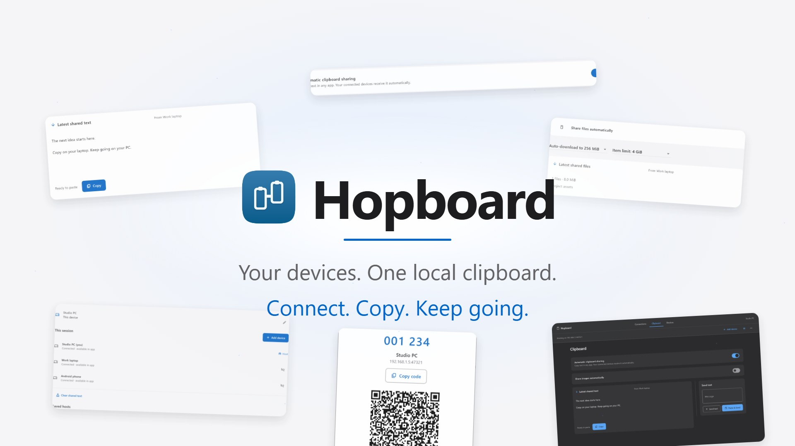
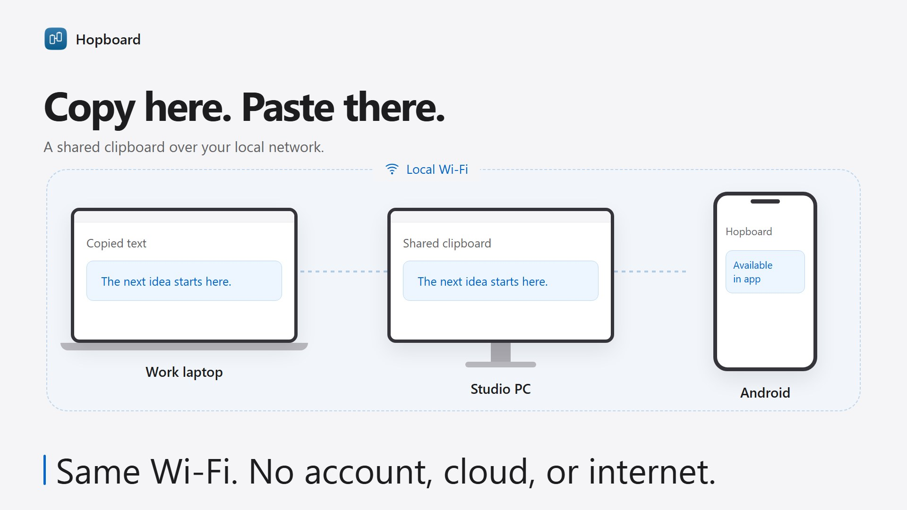
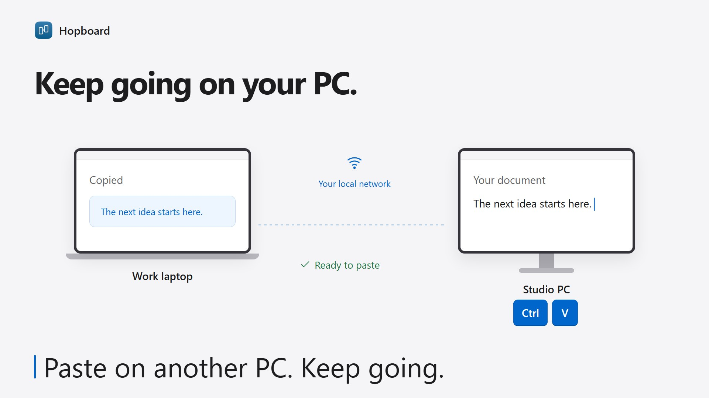
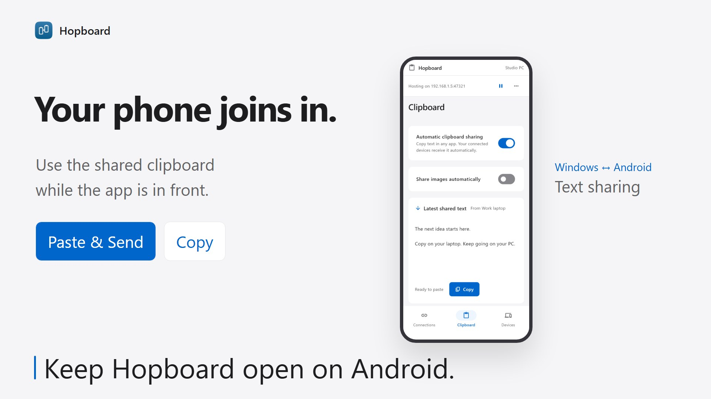
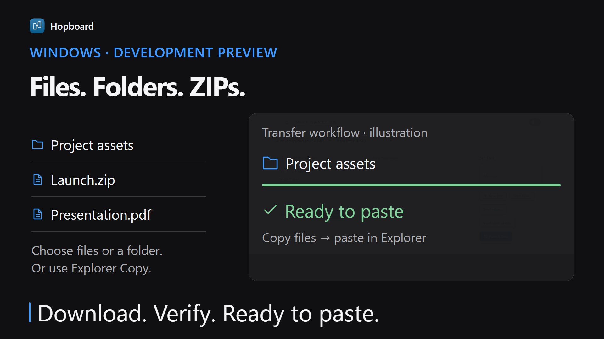

# Hopboard

**Copy on one device. Paste on another. Nothing leaves your Wi-Fi.**

[](docs/media/Hopboard-Trailer.mp4)

<p align="center"><a href="docs/media/Hopboard-Trailer.mp4"><b>▶ Watch the 60-second trailer</b></a> (MP4, 6.8 MB)</p>

<table>
  <tr>
    <td width="50%"></td>
    <td width="50%"></td>
  </tr>
  <tr>
    <td width="50%"></td>
    <td width="50%"></td>
  </tr>
</table>

<sub>Trailer and posters use illustrated app screens with invented devices and content, not recordings of real devices. Windows image and file sharing is a development preview; the Android scenes show foreground text sharing.</sub>

Hopboard moves text between your own devices over your local network. It needs no account, cloud server or internet connection. Devices pair once with a six-digit code and the host approves each one. Shared text lives in memory for five minutes and is never written to disk.

**Security design**

- **Pairing:** the six-digit code is verified with SRP-6a, so the code itself is never sent over the network. The exchange is bound to the host's TLS certificate, so a device pretending to be the host fails.
- **Connections:** TLS 1.2+ with certificate pinning, length-limited messages, and per-device rate limits.
- **Discovery:** devices find each other with mDNS, but discovery is never trusted on its own; the pinned certificate decides.
- **Clipboard privacy:** copies that password managers mark as private are never sent automatically.
- **Tested:** automated tests cover real TLS connections and attack cases such as spoofed hosts, guessed codes and connection floods.

Built with Flutter and Dart for Windows and Android (iPhone source included, not yet built). Current source is 0.2.0-dev; the published 0.1.2 development build predates image/file sharing. Physical-device testing and the reliability gates in [IMPLEMENTATION.md](IMPLEMENTATION.md) are required before public release. This code has not had an independent security audit. The Windows installer is unsigned, so Windows SmartScreen will warn when you run it.

## Download

Get the Windows installer from the [releases page](https://github.com/Azrinfreeman/hopboard/releases). **0.2.0-dev** is a pre-release with image, file and folder sharing for Windows; **0.1.2** is the earlier text-only build. Both are unsigned development builds, so Windows SmartScreen will warn; check the download against the attached `.sha256` file. An Android APK is not on a release yet.

## In development: Windows images, files and folders

The 0.2.0 source supports clipboard images, mixed text/image copies, Explorer files and folders, file/folder pickers, drag onto the window, and explicit ZIP packaging. Automatic image and file sharing each require separate consent. Use **Copy**, rather than Cut, for Explorer transfers. Windows clipboard integration passes local automated checks; two-PC Explorer/Office paste remains unverified. The 0.2.0-dev installer is published as a pre-release.

Files up to 256 MiB download automatically when file consent and automatic sharing are enabled; larger items wait for **Download**. The item limit defaults to 4 GiB and can be reduced. Files are verified before **Ready to paste** appears. Phone image/file workflows remain pending.

## What's new in 0.1.2

- **Renamed to Hopboard** and a redesigned interface with light, dark and high-contrast themes.
- **Private copies stay private:** text that a password manager marks as private is never sent automatically. Text Hopboard places on the Windows clipboard is kept out of Win+V history and Cloud Clipboard.
- **Harder to spoof or disrupt:** a fake nearby announcement can no longer redirect or unpair a saved host. Connections that have not logged in are capped, and pairing-code attempts count only when a code is submitted, with at most three per device.
- **Clearer approvals:** the host sees the requesting device's address and a warning when a request would replace a saved device.
- **Fewer surprises:** a tray notice names the device that replaced your clipboard, the host stays on the network adapter you chose, and a full session no longer makes a device forget its host.
- **Recovery:** if secure storage cannot be read, the startup screen offers **Reset this device**.

## Try it

### Windows

Download and run `Hopboard-Setup-<version>-x64.exe` from the releases page for a per-user installation with a Start menu shortcut, optional desktop shortcut, and uninstaller. It includes the required x64 Visual C++ runtime DLLs and does not require administrator rights. Quit any running copy from its tray menu before installing or updating. The installer and application are unsigned.

For a portable copy:

Extract `dist/Hopboard-Windows-x64.zip` and run `local_clipboard.exe` from the extracted folder. Keep its DLLs and `data` folder together. The app is unsigned. A machine without the Visual C++ runtime may need Microsoft's [x64 redistributable](https://learn.microsoft.com/en-us/cpp/windows/latest-supported-vc-redist).

When updating, choose **Quit** from the existing app's tray menu before replacing its folder or opening the new version. Closing its window alone keeps the older process running. Use version 0.1.2 or later on both devices for six-digit pairing; use 0.2.0-dev on both to share images and files.

1. Connect both devices to the same Wi-Fi. Prefer the Windows computer as host.
2. Select the Wi-Fi interface and choose **Start session**. Allow inbound access on **Private networks** if Windows asks. Avoid guest Wi-Fi with device isolation.
3. Choose **Add device**. On the other PC choose **Enter pairing code**, select the nearby host, and type or paste its six digits (shown like `001 234`). Accept the device on the host. Phones can use **Scan pairing code** or the same six-digit flow.
4. Open **Clipboard**. Enable **Automatic sharing** on Windows after reading the consent notice. New copies then sync; starting the app does not send your pre-existing clipboard.
5. On a phone, keep the app open and use **Paste & Send** to send or **Copy** to receive. Typed text works too. A phone can host while it stays in the foreground.

Closing the Windows window leaves the app in the tray. Right-click the tray icon to open, pause, or quit. A second launch reopens the existing window. **Pause sharing** stops automatic capture and clipboard replacement. **Quit** stops the process and hosting. When incoming text replaces your clipboard while the window is not in front, a quiet tray notice names the sending device; it never shows the text.

PC-to-PC pairing needs no camera or JSON. **Copy code** copies only the six digits. If the host does not appear nearby, select **Enter host address instead** and enter the address shown below its code, such as `192.168.1.5:47321`. The code expires after two minutes, is consumed by successful pairing, and allows five wrong codes before locking, at most three of them from any one device. Connections that never submit a code do not count. The approval prompt shows the requesting device's address and warns when it would replace a saved device. **Create new code** refreshes both the code and QR invitation. Keep the invitation window open until approval. Saved devices reconnect without entering another code. Full invitations remain under the advanced options for compatibility with older builds.

### Android

Use `dist/LocalClipboard-Android-arm64.apk` (built before the rename, so it still shows the previous name; rebuild with `tools/build_android.ps1` for a Hopboard build) on a modern ARM64 phone. Other architecture builds are in `build/app/outputs/flutter-apk/`. Allow installation from the application used to open the APK. Grant local-network access when joining or hosting; camera access is needed only to scan.

This optimized development APK uses the Android debug signing key. Configure a private release key before distribution or publishing.

### iPhone

iOS source is included. An iPhone build requires a Mac, Xcode, a signing team, and device provisioning. No iOS binary is produced on this Windows machine. The native paste control and phone hosting need real-iPhone validation.

## Sharing behavior

| Device | Automatic behavior | Explicit action |
| --- | --- | --- |
| Windows | Optional event-driven text capture; images and files require separate consent, including tray mode | Paste & Send / Copy, Send files/folder, Download, Show in folder |
| Android 10+ | Optional capture and incoming updates while the app has focus | Paste & Send / Copy |
| iPhone, iOS 16+ | Reconnect and show the latest item while active | Native Paste & Send / Copy |

Phones cannot provide unrestricted background clipboard sharing. Moving a phone host to the background stops its session. A joined phone reconnects when reopened. **Keep screen awake** is available during phone hosting. Platform sources and the interaction contract are in [IMPLEMENTATION.md](IMPLEMENTATION.md).

The app preserves text copied while disconnected or outside the phone app. If it cannot safely replace the clipboard, choose **Use received text** or **Send my text**. Simultaneous sends are resolved explicitly. “Available in app” and “Ready to paste” are separate states.

Text is limited to 64 KiB in UTF-8 and expires after five minutes. File items expire after fifteen minutes. Expiry and host **Clear** remove shared app state; they do not erase an OS clipboard, pasted copies, or another app's clipboard history. Automatic mode shares with every trusted member: pause before copying private content. Copies that their app marks private, such as passwords from a password manager, are never sent automatically; use **Paste & Send** to share one deliberately. On Windows, items the app places on the clipboard are excluded from Win+V history and Cloud Clipboard. Mobile images/files, history, and cloud sync remain pending.

Windows can share PNG clipboard images and mixed text/image copies, with image previews and manual copying. Images are limited to 16 MiB and 50 megapixels and stay in memory. Received files are written to `%LOCALAPPDATA%\Hopboard\Received` so Explorer can paste them. This private cache is not indexed and received files carry Windows' downloaded-content marker. Retained files count toward a cache limit of twice your item limit, and downloads require at least 1 GiB of free disk space afterward. Files are removed after expiry/clear once the clipboard no longer references them, at most one hour after expiry, and on startup, **Clear received files**, Quit or uninstall. Clearing this cache can invalidate file paths still on your clipboard. ZIP packaging also uses this directory temporarily; source files are never modified and received ZIPs are never extracted automatically.

The Windows Update action uses the internet only when pressed and verifies the release installer before launch; actual installer validation is still required. See [RICH_CONTENT_PLAN.md](RICH_CONTENT_PLAN.md) for implementation status and remaining device checks.

## Connection and privacy

- A host plus seven clients use pinned TLS connections and bounded, length-prefixed JSON. Hosting uses TCP port **47321**, TLS 1.2 or newer.
- Invitations expire after two minutes, are single-use, and require host approval. Saved credentials reconnect without repeating pairing. The host can revoke devices.
- Six-digit pairing uses PointyCastle SRP-6a (3072-bit group, SHA-256), mutual proofs, and a certificate-bound confirmation before approval or credential issuance. The code is never transmitted, advertised, logged, or persisted. A bootstrap TLS socket is quarantined until the code authenticates its exact certificate; normal sessions always enforce the saved pin. Use the updated app on both devices for code pairing.
- Windows DPAPI, Android KeyStore-backed AES-GCM, and iOS Keychain protect stored identity/trust. If that storage becomes unreadable, for example after a Windows password reset, the startup screen offers **Reset this device**, which deletes the identity and pairings so you can pair again. The app does not persist shared clipboard text. Your OS or other clipboard tools may retain their own copies.
- The host and paired members can read shared content. QR invitations contain a temporary secret; show or transfer them only to the intended device.
- Discovery uses `_localclip._tcp` and advertises identity/version only. Discovered addresses are checked against the stored certificate pin. Direct invitations remain available when multicast is blocked.
- v1 accepts private/local IPv4 only. Public addresses, DNS hostnames, IPv6, cloud relays, router forwarding, and automatic host migration are outside this version.

If connection fails, check the LAN, permissions, host sleep, and selected Wi-Fi adapter. VPNs, guest-network isolation, or an inbound firewall block can interfere. Use a Private-network firewall rule scoped to this app/local subnet; do not disable the firewall. If discovery cannot find a changed host address, update it under **Devices**. A nearby advertisement is used only after the host proves its saved certificate, so a spoofed advertisement cannot redirect or unpair a device. Certificate identity changes require pairing again. A host keeps listening on the adapter chosen at start; to move to another network, stop and restart hosting.

## Build from source

Verified toolchain: Flutter **3.47.6** stable / Dart **3.13.5**. Dependencies are locked in `pubspec.lock`. Windows, Android, and iOS targets are included.

```powershell
flutter pub get
flutter analyze
flutter test --reporter expanded

# Visual Studio Desktop development with C++ and Windows SDK required.
./tools/build_windows.ps1

# Inno Setup 6 and Visual Studio x64 CRT redistributable files required.
./tools/build_windows_installer.ps1
# Package an already-built release without rebuilding:
./tools/build_windows_installer.ps1 -SkipBuild

# Android SDK platforms 36 and 37.0, build tools 36.0.0, NDK 28.2.13676358.
# Pass -JavaHome if Flutter cannot find a compatible installed JDK.
./tools/build_android.ps1 -AndroidSdk "C:/path/to/Android/Sdk"
```

The scripts create the Windows ZIP and ARM64 APK in `dist/` with SHA-256 checksums. They do not change the firewall, install the app, or start sharing. The Android script uses `.tools/android` by default if that workspace SDK exists. Tool caches are excluded from source control.

On a Mac with Flutter, Xcode, and Apple provisioning:

```sh
flutter pub get
flutter build ios --release --no-codesign
open ios/Runner.xcworkspace
# Select a signing team, provision a real iPhone, then run/archive in Xcode.
```

The unsigned command checks compilation; a signed archive/device run requires provisioning. iOS integration has not been compiled in this Windows environment.

## Status and limits

- Checked on Windows with Flutter 3.47.6: `flutter analyze` is clean and all 50 automated tests pass, including real TLS connections and attack cases.
- Not yet verified: physical Android phones, iPhone (source only), and the Windows tray notification and clipboard-privacy checks on a range of password managers.
- No independent security audit has been done. Treat Hopboard as a learning and portfolio project, not a vetted security product.

## Code and verification

`lib/core/` contains transport, identity, pairing, and session state. `lib/app/` contains the UI and clipboard/reconnect coordination. `lib/platform/` defines clipboard, storage, and discovery boundaries. C++, Kotlin, and Swift adapters provide native behavior.

`test/` exercises real pinned TLS loopback sessions and controllable clipboard adapters: message limits, pairing, revocation, ordering, deduplication, rapid copies, pause/resume, reconnection, and clipboard races. `integration_test/windows_smoke_test.dart` exercises native encrypted storage, listener/tray initialization, and UI startup without reading or replacing the user's clipboard.

See [VALIDATION.md](VALIDATION.md) for verified results and remaining gates. The seamless-sharing criteria, physical-device matrix, and expansion plan are in [IMPLEMENTATION.md](IMPLEMENTATION.md).
