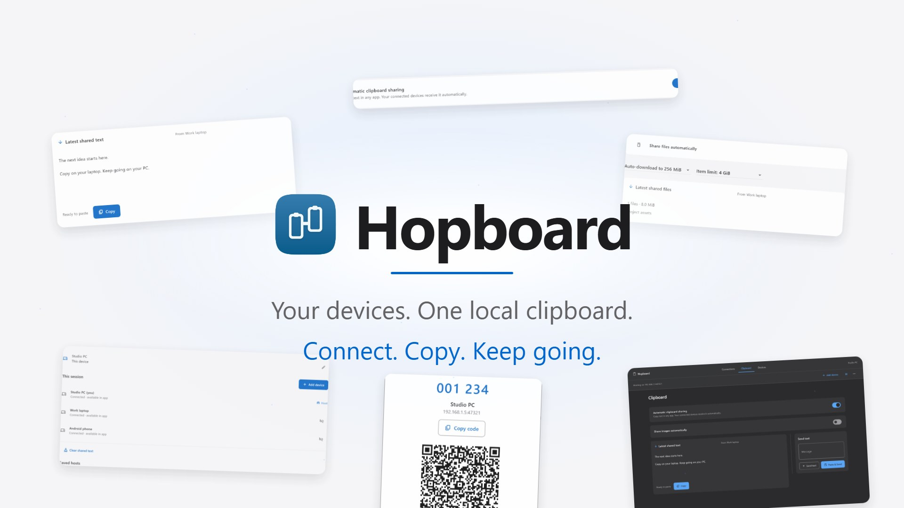
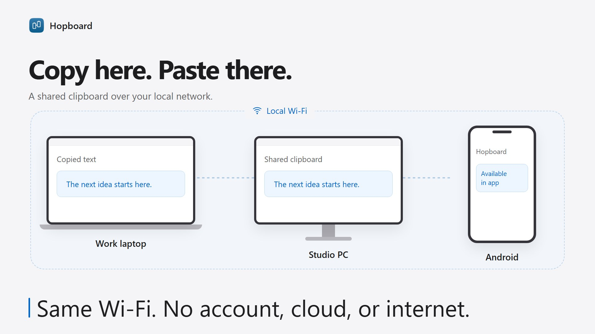
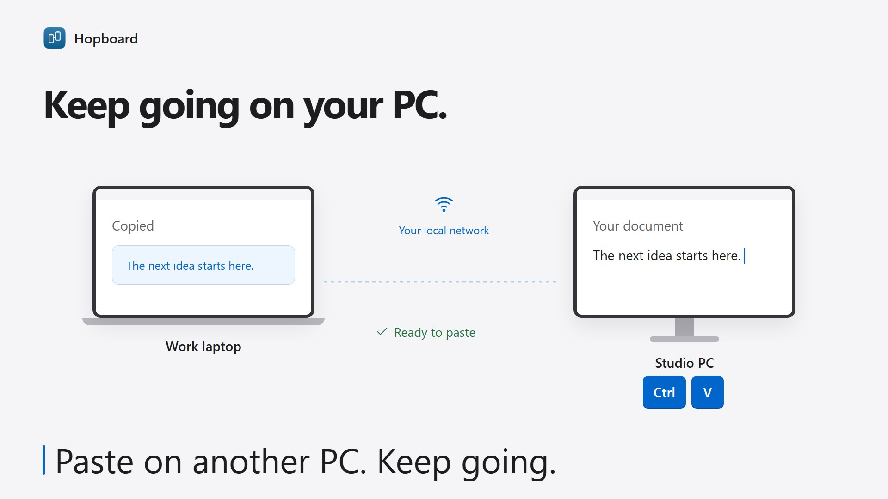
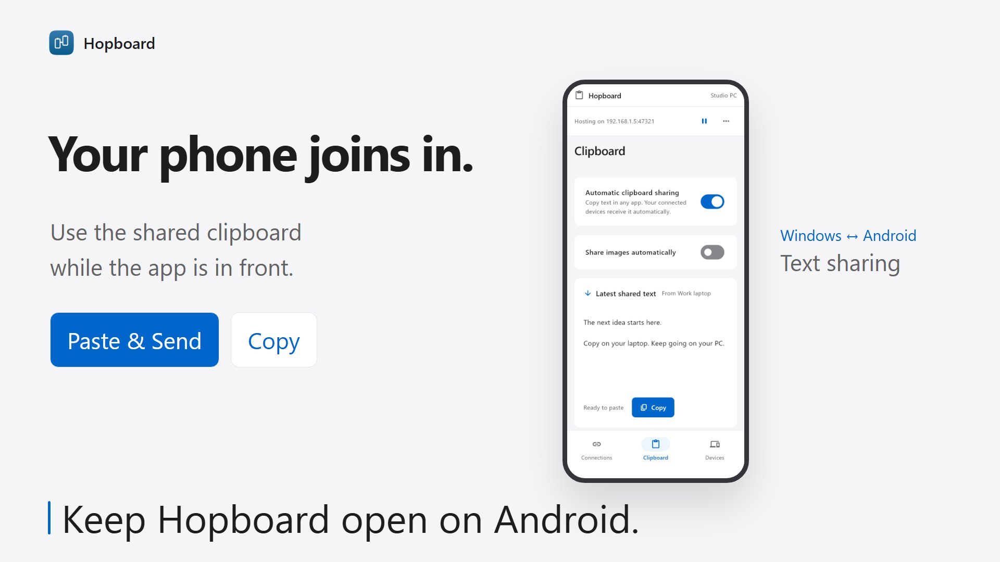
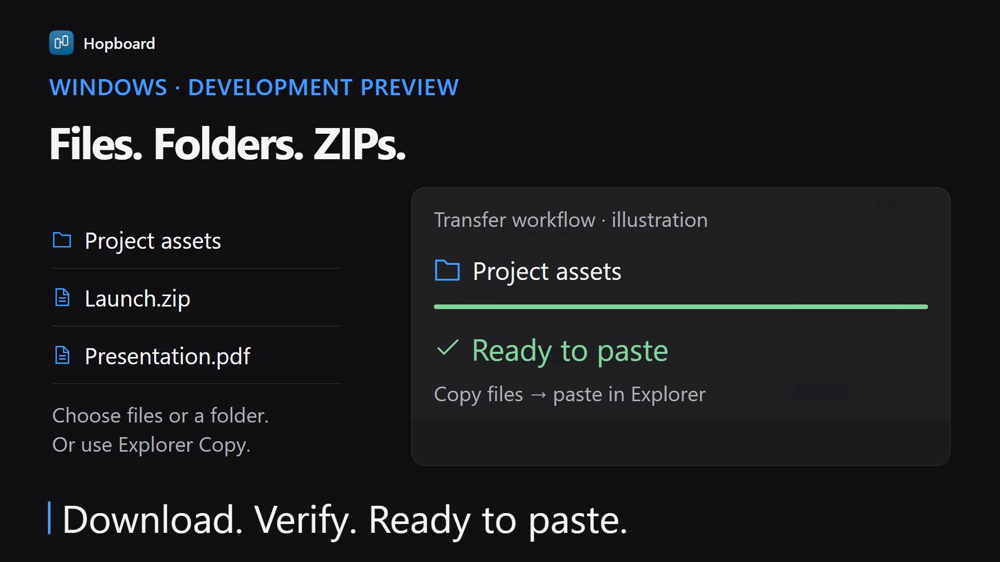

# Hopboard

**Copy on one device. Paste on another. Nothing leaves your Wi-Fi.**

[](docs/media/Hopboard-Trailer.mp4)

<p align="center"><a href="docs/media/Hopboard-Trailer.mp4"><b>▶ Watch the 60-second trailer</b></a> (MP4, 6.8 MB)</p>

<table>
  <tr>
    <td width="50%"></td>
    <td width="50%"></td>
  </tr>
  <tr>
    <td width="50%"></td>
    <td width="50%"></td>
  </tr>
</table>

<sub>Trailer and posters use illustrated app screens with invented devices and content, not recordings of real devices. Windows image and file sharing is a development preview; the Android scenes show foreground text sharing.</sub>

Hopboard moves text between your own devices over your local network. It needs no account, cloud server or internet connection. Devices pair once with a six-digit code and the host approves each one. Shared text lives in memory for five minutes and is never written to disk.

**Security design**

- **Pairing:** the six-digit code is verified with SRP-6a, so the code itself is never sent over the network. The exchange is bound to the host's TLS certificate, so a device pretending to be the host fails.
- **Connections:** TLS 1.2+ with certificate pinning, length-limited messages, and per-device rate limits.
- **Discovery:** devices find each other with mDNS, but discovery is never trusted on its own; the pinned certificate decides.
- **Clipboard privacy:** copies that password managers mark as private are never sent automatically.
- **Tested:** automated tests cover real TLS connections and attack cases such as spoofed hosts, guessed codes and connection floods.

Built with Flutter and Dart for Windows and Android (iPhone source included, not yet built). Current source is 0.3.1+16: Windows seamless clipboard, a security-hardening pass, and signed in-app updates. The 0.3.1 release carries a Windows installer and a release-signed Android ARM64 APK. The owner confirmed Android D20 sending works; a [background callback diagnostic](docs/tutorial/android-send.md#try-the-d21-callback-test) exists for the D21 experiment. Automatic background sending still needs that device result and a later overlay/focus check. Physical-device checks are still incomplete. This code has not had an independent security audit. The Windows installer has no Authenticode signature, so Windows SmartScreen will warn when you run it; its update manifest is signed separately (see [Signed updates](#signed-updates-windows)).

## Download

Get the Windows installer from the [0.3.1 release](https://github.com/Azrinfreeman/hopboard/releases/tag/v0.3.1). It includes the seamless clipboard: newest copy wins, files that stream while Explorer pastes, and formatted text. Install it on every PC; earlier releases lack these. The installer has no Authenticode signature, so Windows SmartScreen will warn; check the download against the attached `.sha256` file. Quit Hopboard from its system tray menu before upgrading.

The Android ARM64 APK (`Hopboard-Android-arm64.apk`) is attached to the same release. It is signed with the owner release key, certificate SHA-256 `9a2bdc94972cbb1a2d58030056c5cf891bc97969c47d6e91ee96fcdcab305ecd`, and installs as `io.github.azrinfreeman.hopboard` (version 0.3.1, versionCode 2016). Verify the file against its `.sha256` and the certificate fingerprint. Physical-device checks are not complete, so treat Android as a preview.

0.3.1 adds the security changes below and is the first release built with the update-signing key pinned in the app. Earlier installs, including any 0.3.0 installed before this release, cannot verify updates, so install 0.3.1 manually once; later updates can then happen in the app.

## Security hardening in 0.3.1

- **Android share confirmation:** text shared into Hopboard from another app asks for confirmation before it is sent.
- **Clipboard formatting:** HTML and RTF are checked and dropped when they could leak credentials; plain text is kept.
- **File names:** Unicode and bidirectional-control tricks in received file names are rejected.
- **Pairing limits:** declining or timing out a request ends the invitation, so the same code or QR cannot be reused. Each address may start at most 6 pairing exchanges per invitation (30 in total).
- **Transfer limits:** one device can hold at most half of the host's transfer tickets.
- **Streamed files:** the final byte is withheld until the file hash passes, so a paste cannot complete with unverified data.
- **Risky file types:** received files such as `.exe`, `.lnk`, `.url`, `.bat`, `.ps1`, `.msi` and `.dll` show a warning banner. Transfers are not blocked. The list is in `lib/core/content.dart`.
- **Android backup:** the encrypted identity and pairings are excluded from cloud backup and device-to-device transfer.
- **Uninstall:** the installer also removes the downloaded-updates cache. The pairing identity is kept so a reinstall keeps its pairings.

Known gap: a flood of connections that start but never finish the TLS handshake can still tie up sockets on the local network. Dart does not allow closing them safely.

## Signed updates (Windows)

The **Update** action downloads from this repository's latest release and installs only if the release carries `Hopboard-Setup-<version>-x64.exe.manifest.json` and `.manifest.sig`, and the signature verifies against the RSA-3072 public key pinned in `UpdateService.updateSigningPublicKeyPem` (`lib/platform/update_service.dart`). The manifest records the version, file name, size and SHA-256 of the installer. The private key is held offline outside the repository; losing it means no future update would be accepted by installed copies. Release steps are in [docs/RELEASING.md](docs/RELEASING.md). This protects update integrity; it is not Windows code signing.

## Seamless clipboard on Windows

Copy on one Windows PC and paste on another with **Ctrl+V**, without opening Hopboard or clicking Copy. This works in both directions: a guest's copy goes through the host to every other PC.

- **One consent.** Turning on **Automatic clipboard sharing** on Windows also turns on images and files. Private copies from password managers are still never sent.
- **Newest copy wins.** A live copy from any device replaces the other PCs' clipboards, even over a protected local copy. A copied pairing invitation is never replaced. Turn off **Newest copy always wins** in Clipboard settings to keep local copies protected. If two PCs copy at almost the same moment, the copy that reaches the host first wins.
- **Files and videos appear on the clipboard at once, at any size.** Explorer streams the bytes while it pastes and shows its normal progress dialog. Files up to the prefetch limit (default 256 MiB) download straight away and then become ordinary files for apps that need a file path. Pasted files keep the "downloaded from the internet" mark.
- **Formatted text.** HTML and RTF formatting travels with plain text (up to 256 KiB).
- **If the sender disconnects mid-paste,** the paste fails with Explorer's normal read error instead of hanging. A fresh copy is needed once it reconnects.

Limits: every PC needs 0.3.0 (earlier installers have none of it); formatted text needs the sender, host and receiver updated; Office-native formats are not carried; browsers copy a video as its address, which is shared as text. Android cannot read the clipboard in the background, so it is unchanged.

## Windows images, files and folders

Hopboard supports clipboard images, mixed text/image copies, Explorer files and folders, file/folder pickers, drag onto the window, and explicit ZIP packaging. Automatic image and file sharing each require separate consent. Use **Copy**, rather than Cut, for Explorer transfers. Windows clipboard integration passes local automated checks; two-PC Explorer/Office paste remains unverified.

Files up to 256 MiB download automatically when file consent and automatic sharing are enabled; larger items wait for **Download**. In 0.3.0, received files of any size are instead on the clipboard at once and stream while Explorer pastes them; smaller ones prefetch and become ordinary files. The item limit defaults to 4 GiB and can be reduced. Files are verified before **Ready to paste** appears. Phone image/file workflows remain pending.

## Everyday safeguards

- **Renamed to Hopboard** and a redesigned interface with light, dark and high-contrast themes.
- **Private copies stay private:** text that a password manager marks as private is never sent automatically. Text Hopboard places on the Windows clipboard is kept out of Win+V history and Cloud Clipboard.
- **Harder to spoof or disrupt:** a fake nearby announcement can no longer redirect or unpair a saved host. Connections that have not logged in are capped, and pairing-code attempts count only when a code is submitted, with at most three per device.
- **Clearer approvals:** the host sees the requesting device's address and a warning when a request would replace a saved device.
- **Fewer surprises:** a tray notice names the device that replaced your clipboard, the host stays on the network adapter you chose, and a full session no longer makes a device forget its host.
- **Recovery:** if secure storage cannot be read, the startup screen offers **Reset this device**.

## Try it

### Windows

Download and run `Hopboard-Setup-<version>-x64.exe` from the releases page for a per-user installation with a Start menu shortcut, optional desktop shortcut, and uninstaller. It includes the required x64 Visual C++ runtime DLLs and does not require administrator rights. Quit any running copy from its tray menu before installing or updating. The installer and application have no Authenticode signature.

For a portable copy:

Extract `dist/Hopboard-Windows-x64.zip` and run `local_clipboard.exe` from the extracted folder. Keep its DLLs and `data` folder together. The app has no Authenticode signature. A machine without the Visual C++ runtime may need Microsoft's [x64 redistributable](https://learn.microsoft.com/en-us/cpp/windows/latest-supported-vc-redist).

When updating, choose **Quit** from the existing app's tray menu before replacing its folder or opening the new version. Closing its window alone keeps the older process running. Run 0.3.0 or later on every device: older builds lack six-digit pairing, image and file sharing, or the seamless clipboard.

1. Connect both devices to the same Wi-Fi. Prefer the Windows computer as host.
2. Select the Wi-Fi interface and choose **Start session**. Allow inbound access on **Private networks** if Windows asks. Avoid guest Wi-Fi with device isolation.
3. Choose **Add device**. On the other PC choose **Enter pairing code**, select the nearby host, and type or paste its six digits (shown like `001 234`). Accept the device on the host. Phones can use **Scan pairing code** or the same six-digit flow.
4. Open **Clipboard** on **both Windows PCs**. Enable **Automatic clipboard sharing** on each and accept the consent notice. This shares each PC's new copies with trusted session members and lets incoming text replace its clipboard. A receiver with sharing off also offers **Enable automatic sharing** beside received text.
5. On Android, select text in another app and choose **Share, then Hopboard**, or enable **Receive in the background** and tap **Send to PC** in the connection notification after copying. **Paste & Send** and typed text still work. See [Android sending](docs/tutorial/android-send.md) for setup and limits. PC-to-phone automatic receive requires automatic sharing and background receive; a phone can host while it stays in the foreground.

After enabling both PCs, copy fresh text on the host. On the connected PC, switch to Notepad or another destination app and press **Ctrl+V**. You do not need to open Hopboard or click Copy for each item. Hopboard shows **Ready to paste — press Ctrl+V in another app** after confirming the clipboard write; **Copy again** is optional recovery. Hopboard never pastes into an app for you.

Enabling sharing preserves the currently displayed item and pre-existing clipboard; test with a new host copy. Starting the app does not send old clipboard content. Private copies, local copies made while sharing was inactive, unresolved simultaneous sends, and failed writes can still need deliberate **Copy** or conflict resolution. Read the displayed reason before replacing local content. On Windows, **Newest copy always wins** (on by default) lets a live copy from another device replace these protected local copies too; only a copied invitation stays protected. Pausing or changing automatic mode clears the previous ready indication; the next eligible fresh copy can become ready again.

Closing the Windows window leaves the app in the tray. Right-click the tray icon to open, pause, or quit. A second launch reopens the existing window. **Pause sharing** stops automatic capture and clipboard replacement. **Quit** stops the process and hosting. When incoming text replaces your clipboard while the window is not in front, a quiet tray notice names the sending device; it never shows the text.

PC-to-PC pairing needs no camera or JSON. **Copy code** copies only the six digits. If the host does not appear nearby, select **Enter host address instead** and enter the address shown below its code, such as `192.168.1.5:47321`. The code expires after two minutes, is consumed by successful pairing, and allows five wrong codes before locking, at most three of them from any one device. Connections that never submit a code do not count. The approval prompt shows the requesting device's address and warns when it would replace a saved device. **Create new code** refreshes both the code and QR invitation. Keep the invitation window open until approval. Saved devices reconnect without entering another code. Full invitations remain under the advanced options for compatibility with older builds.

### Android

Run `tools/build_android.ps1` to create `dist/Hopboard-Android-arm64.apk` for a modern ARM64 phone. Other architecture builds are in `build/app/outputs/flutter-apk/`. Allow installation from the application used to open the APK. Grant local-network access when joining or hosting; camera access is needed only to scan.

The build script requires an owner-held release key and verifies the signer certificate, package name, version and ARM64-only contents before copying the APK to `dist/`. See the [release-signing tutorial](docs/tutorial/release-signing.md). Without a configured key no APK is produced.

### iPhone

iOS source is included. An iPhone build requires a Mac, Xcode, a signing team, and device provisioning. No iOS binary is produced on this Windows machine. The native paste control and phone hosting need real-iPhone validation.

## Sharing behavior

| Device | Automatic behavior | Explicit action |
| --- | --- | --- |
| Windows | Optional event-driven text capture; images and files require separate consent, including tray mode | Paste & Send / Copy, Send files/folder, Download, Show in folder |
| Android 10+ | Optional capture and incoming updates while the app has focus | Paste & Send / Copy |
| iPhone, iOS 16+ | Reconnect and show the latest item while active | Native Paste & Send / Copy |

Phones cannot provide unrestricted background clipboard sharing. Moving a phone host to the background stops its session. A joined phone reconnects when reopened. **Keep screen awake** is available during phone hosting.

The app preserves text copied while disconnected or outside the phone app. If it cannot safely replace the clipboard, choose **Use received text** or **Send my text**. Simultaneous sends are resolved explicitly. “Available in app” and “Ready to paste” are separate states.

On Windows, ordinary text already on the clipboard is preserved when connecting or first enabling Automatic sharing. A later fresh remote text copy replaces it automatically; initial session snapshots and duplicate updates do not. Private content, copied invitations, and local edits made while sharing was paused, disconnected or disabled remain protected. A confirmed local send releases protection for that specific copy, so subsequent remote copies can arrive automatically.

Automatic capture and clipboard replacement retry temporary clipboard contention for up to five seconds. A successful write is confirmed separately, so a busy confirmation read does not repeat the write or create a false local-copy conflict. Hopboard explains when a local copy is protected, automatic image/file sharing is off, or a file exceeds the automatic download limit. Explorer-copied videos follow the same file limits; larger videos still require **Download**.

Text is limited to 64 KiB in UTF-8 and expires after five minutes. File items expire after fifteen minutes. Expiry and host **Clear** remove shared app state; they do not erase an OS clipboard, pasted copies, or another app's clipboard history. Automatic mode shares with every trusted member: pause before copying private content. Copies that their app marks private, such as passwords from a password manager, are never sent automatically; use **Paste & Send** to share one deliberately. On Windows, items the app places on the clipboard are excluded from Win+V history and Cloud Clipboard. Mobile images/files, history, and cloud sync remain pending.

Windows can share PNG clipboard images and mixed text/image copies, with image previews and manual copying. Images are limited to 16 MiB and 50 megapixels and stay in memory. Received files are written to `%LOCALAPPDATA%\Hopboard\Received` so Explorer can paste them. This private cache is not indexed and received files carry Windows' downloaded-content marker. Retained files count toward a cache limit of twice your item limit, and downloads require at least 1 GiB of free disk space afterward. Files are removed after expiry/clear once the clipboard no longer references them, at most one hour after expiry, and on startup, **Clear received files**, Quit or uninstall. Clearing this cache can invalidate file paths still on your clipboard. ZIP packaging also uses this directory temporarily; source files are never modified and received ZIPs are never extracted automatically.

The Windows Update action uses the internet only when pressed and verifies the signed manifest and the installer's SHA-256 before launch; see [Signed updates](#signed-updates-windows).

## Connection and privacy

- A host plus seven clients use pinned TLS connections and bounded, length-prefixed JSON. Hosting uses TCP port **47321**, TLS 1.2 or newer.
- Invitations expire after two minutes, are single-use, and require host approval. Saved credentials reconnect without repeating pairing. The host can revoke devices.
- Six-digit pairing uses PointyCastle SRP-6a (3072-bit group, SHA-256), mutual proofs, and a certificate-bound confirmation before approval or credential issuance. The code is never transmitted, advertised, logged, or persisted. A bootstrap TLS socket is quarantined until the code authenticates its exact certificate; normal sessions always enforce the saved pin. Use the updated app on both devices for code pairing.
- Windows DPAPI, Android KeyStore-backed AES-GCM, and iOS Keychain protect stored identity/trust. If that storage becomes unreadable, for example after a Windows password reset, the startup screen offers **Reset this device**, which deletes the identity and pairings so you can pair again. The app does not persist shared clipboard text. Your OS or other clipboard tools may retain their own copies.
- The host and paired members can read shared content. QR invitations contain a temporary secret; show or transfer them only to the intended device.
- Discovery uses `_localclip._tcp` and advertises identity/version only. Discovered addresses are checked against the stored certificate pin. Direct invitations remain available when multicast is blocked.
- v1 accepts private/local IPv4 only. Public addresses, DNS hostnames, IPv6, cloud relays, router forwarding, and automatic host migration are outside this version.

If connection fails, check the LAN, permissions, host sleep, and selected Wi-Fi adapter. VPNs, guest-network isolation, or an inbound firewall block can interfere. Use a Private-network firewall rule scoped to this app/local subnet; do not disable the firewall. If discovery cannot find a changed host address, update it under **Devices**. A nearby advertisement is used only after the host proves its saved certificate, so a spoofed advertisement cannot redirect or unpair a device. Certificate identity changes require pairing again. A host keeps listening on the adapter chosen at start; to move to another network, stop and restart hosting.

## Build from source

Verified toolchain: Flutter **3.47.6** stable / Dart **3.13.5**. Dependencies are locked in `pubspec.lock`. Windows, Android, and iOS targets are included.

```powershell
flutter pub get
flutter analyze
flutter test --reporter expanded

# Visual Studio Desktop development with C++ and Windows SDK required.
./tools/build_windows.ps1

# Inno Setup 6 and Visual Studio x64 CRT redistributable files required.
./tools/build_windows_installer.ps1
# Package an already-built release without rebuilding:
./tools/build_windows_installer.ps1 -SkipBuild

# Sign the installer for the in-app updater (key kept outside the repository).
# First time only: dart run tools/update_signing.dart generate <key-file>
dart run tools/update_signing.dart sign <private-key-file> dist/Hopboard-Setup-<version>-x64.exe

# Android SDK platforms 36 and 37.0, build tools 36.0.0, NDK 28.2.13676358.
# Pass -JavaHome if Flutter cannot find a compatible installed JDK.
# Configure an owner-held release key first; see docs/tutorial/release-signing.md.
./tools/build_android.ps1 -AndroidSdk "C:/path/to/Android/Sdk" -ExpectedSignerSha256 'YOUR_CERTIFICATE_SHA256'
```

The scripts create the Windows ZIP and ARM64 APK in `dist/` with SHA-256 checksums. They do not change the firewall, install the app, or start sharing. The Android script uses `.tools/android` by default if that workspace SDK exists. Tool caches are excluded from source control.

On a Mac with Flutter, Xcode, and Apple provisioning:

```sh
flutter pub get
flutter build ios --release --no-codesign
open ios/Runner.xcworkspace
# Select a signing team, provision a real iPhone, then run/archive in Xcode.
```

The unsigned command checks compilation; a signed archive/device run requires provisioning. iOS integration has not been compiled in this Windows environment.

## Roadmap and next milestones

- [ ] **Android file & image sharing:** file/image pickers, system share target for media, and receiving files into the local application cache.
- [ ] **In-app update verification:** verify end-to-end update delivery, RSA-3072 signature check, and installer launch from an existing 0.3.1 client when 0.3.2 is published.
- [ ] **Windows Authenticode code signing:** complete SignPath Foundation open-source signing integration to eliminate Windows SmartScreen warnings.
- [ ] **iOS / iPhone support:** build, test on a physical iPhone, and implement an iOS Share Extension to handle iOS background clipboard limits.
- [ ] **Endurance & multi-network stress testing:** prolonged session stability, Wi-Fi reconnection cycles, and concurrent multi-device transfers.

## Status and limits

- Checked on Windows with Flutter 3.47.6: `flutter analyze` is clean, all 176 automated tests pass, and the Windows installer and signed Android APK build. Coverage includes real TLS connections, clipboard races, direct-paste setup and attack cases.
- Physical device testing: 0.3.1 installer and Android APK have been verified on physical devices (Windows and Android).
- Not yet verified: iPhone (source only), and clipboard-privacy checks on a wider range of third-party password managers.
- No independent security audit has been done. Treat Hopboard as a learning and portfolio project, not a vetted security product.

## Code and verification

`lib/core/` contains transport, identity, pairing, and session state. `lib/app/` contains the UI and clipboard/reconnect coordination. `lib/platform/` defines clipboard, storage, and discovery boundaries. C++, Kotlin, and Swift adapters provide native behavior.

`test/` exercises real pinned TLS loopback sessions and controllable clipboard adapters: message limits, pairing, revocation, ordering, deduplication, rapid copies, pause/resume, reconnection, and clipboard races. `integration_test/windows_smoke_test.dart` exercises native encrypted storage, listener/tray initialization, and UI startup without reading or replacing the user's clipboard.

See [STATUS.md](STATUS.md) for current progress and next steps.

## Licence and release identity

Hopboard's original code is available under the [MIT licence](LICENSE). Third-party dependencies retain their own licences; preserve their notices when distributing builds.

The Android application ID is `io.github.azrinfreeman.hopboard`. Earlier development builds used `dev.localclipboard.local_clipboard`, so the new ID installs as a separate app and does not inherit their pairings. The Kotlin namespace remains unchanged. Release builds require an owner-held key and fail when signing is missing; debug builds remain available. See the [release-signing tutorial](docs/tutorial/release-signing.md).

SignPath Foundation is the selected route to explore for Windows code signing. Eligibility review, application and signing integration remain pending; current Windows installers have no Authenticode signature (only the update manifest is signed).

## Code signing policy

Signing is not active for published Windows assets. [Release preparation](docs/RELEASING.md#code-signing-policy) records the SignPath prerequisites and current status; it does not claim provider approval.
